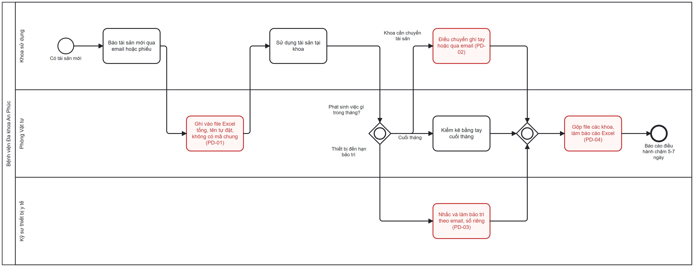
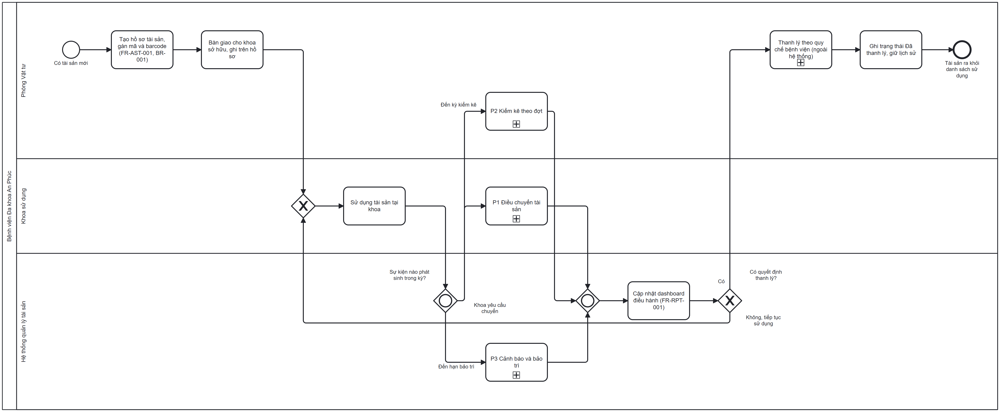

# TÀI LIỆU YÊU CẦU KINH DOANH (BRD)
# Dự án Outsource: Hệ thống Quản lý Tài sản Bệnh viện

> **Phiên bản:** 1.0 | **Ngày:** 26/02/2026
> **Tác giả:** Nguyễn Văn A — BA Lead, Nhà cung cấp
> **Người chịu trách nhiệm:** Nguyễn Văn A — BA Lead (đã rà toàn bộ bản 1.0)
> **Khách hàng:** Bệnh viện Đa khoa An Phúc
> **Nhà cung cấp:** Công ty Giải pháp Số Sao Việt
> **Trạng thái:** Baseline 1.0 — đã ký mục 11 ngày 26/02/2026
> **Tier:** 2 — điểm rủi ro 3/7 (câu 3, 5, 7): hợp đồng outsource giá cố định có mốc thanh toán gắn nghiệm thu, tích hợp SSO và máy in barcode chưa xác nhận; hệ thống không lưu dữ liệu sức khỏe người bệnh
> **Nhãn:** [TÀI LIỆU MẪU] — ví dụ minh họa cấu trúc, không phải dự án thật
> **⚠️ Tài liệu CHỐT PHẠM VI (Baseline) — mọi thay đổi sau khi phê duyệt phải qua quy trình Yêu cầu thay đổi (CR)**

---

## Lịch sử chỉnh sửa

| Phiên bản | Ngày | Thay đổi | Người | Phê duyệt bởi |
|-----------|------|----------|-------|----------------|
| 0.1 | 12/02/2026 | Draft đầu tiên | BA | — |
| 0.2 | 20/02/2026 | Cập nhật theo workshop với Khối Vật tư và CNTT | BA | — |
| 1.0 | 26/02/2026 | **Đã phê duyệt — Chốt phạm vi** | BA | Giám đốc vận hành |

---

## 1. Tóm tắt điều hành

### 1.1. Tóm tắt dự án
Hiện tại bệnh viện đang theo dõi tài sản y tế, thiết bị CNTT, và vật tư giá trị cao bằng Excel rời rạc theo từng khoa. Mỗi đợt kiểm kê cuối tháng, Phòng Vật tư phải hợp nhất nhiều file, đối chiếu giấy bàn giao, rồi gọi điện xác minh với các khoa. Quy trình này chậm, dễ sai, và không cho Ban điều hành thấy ngay tài sản nào đang hỏng, thất lạc, hoặc sắp hết hạn bảo trì.

Dự án này xây dựng một hệ thống quản lý tài sản tập trung để ghi nhận vòng đời tài sản từ mua sắm, bàn giao, điều chuyển, bảo trì, đến thanh lý. Hệ thống phục vụ ba nhóm chính: Phòng Vật tư, các khoa/phòng sử dụng tài sản, và Ban điều hành cần dashboard vận hành.

Đề xuất đầu tư nhằm đạt ba kết quả kinh doanh: giảm ít nhất 70% thời gian kiểm kê tháng, giảm tối thiểu 80% sai lệch giữa sổ theo dõi và tài sản thực tế, và tạo được báo cáo tức thời về tài sản theo khoa, trạng thái, và lịch bảo trì để hỗ trợ quyết định ngân sách.

### 1.2. Mục đích tài liệu
Tài liệu này mô tả **yêu cầu kinh doanh** cho dự án Quản lý Tài sản Bệnh viện, phục vụ:
- Làm cơ sở cho việc **phê duyệt đầu tư** từ Ban lãnh đạo
- Làm baseline cho **hợp đồng outsource** giữa Khách hàng và Nhà cung cấp
- Làm đầu vào cho **SRS** (đặc tả yêu cầu phần mềm chi tiết)

### 1.3. Đối tượng đọc

| Đối tượng | Đọc phần |
|-----------|---------|
| Ban giám đốc / Nhà tài trợ (Sponsor) | Mục 1-3, 7 (Tóm tắt, Luận chứng kinh doanh, Lợi ích đầu tư) |
| Người đại diện KH (Product Owner) / Quản lý kinh doanh | Toàn bộ |
| Quản lý dự án (PM) / Chuyên viên phân tích (BA) Nhà cung cấp | Toàn bộ |
| Đội phát triển Nhà cung cấp | Mục 4-6 (yêu cầu chi tiết) |
| Tài chính / Mua sắm | Mục 3, 7 (Chi phí-Lợi ích, Ngân sách) |
| Pháp lý | Mục 8 (Tuân thủ và giới hạn pháp lý) |

---

## 2. Bối cảnh kinh doanh

### 2.1. Tổ chức
- **Tên tổ chức:** Bệnh viện Đa khoa An Phúc
- **Ngành:** Y tế
- **Quy mô:** 650 nhân sự, 420 giường bệnh, 18 khoa/phòng chuyên môn
- **Vị trí thị trường:** Bệnh viện tư nhân quy mô vừa, đang mở thêm cơ sở vệ tinh

### 2.2. Hiện trạng
| # | Vấn đề hiện tại | Ảnh hưởng | Mức độ | Nguồn · Mức |
|---|-----------------|-----------|--------|-------------|
| 1 | Mỗi khoa giữ một file Excel riêng để theo dõi tài sản | Kiểm kê tháng mất 24-30 giờ công, sai lệch trung bình 12% | 🔴 Nghiêm trọng | SRC-02 · E4 |
| 2 | Không có mã định danh thống nhất cho tài sản khi điều chuyển giữa khoa | Mất dấu tài sản, phát sinh tranh cãi trách nhiệm bàn giao | 🟠 Cao | SRC-01 · E2 |
| 3 | Lịch bảo trì thiết bị theo dõi bằng email và lịch cá nhân | Bỏ lỡ 2-3 lịch bảo trì/tháng, tăng rủi ro dừng thiết bị | 🟠 Cao | SRC-03 · E2 |
| 4 | Ban điều hành không có dashboard tình trạng tài sản theo thời gian thực | Quyết định mua mới và thanh lý dựa trên báo cáo chậm 5-7 ngày | 🟡 Trung bình | SRC-01 · E1, gián tiếp (Phòng Vật tư thuật lại); xác nhận trực tiếp tại buổi duyệt BRD (SRC-04 · E1, XN: biên bản duyệt 26/02/2026) |

### 2.3. Trạng thái mong muốn
```
HIỆN TẠI (AS-IS)                    TƯƠNG LAI (TO-BE)
──────────────────                   ──────────────────
Excel + Email + Giấy       ───▶     Hệ thống quản lý tài sản tập trung
Kiểm kê 3 ngày/tháng       ───▶     Kiểm kê bán tự động trong 1 ngày
Sai lệch 12%               ───▶     Sai lệch < 2%
Báo cáo thủ công 5-7 ngày  ───▶     Dashboard theo thời gian gần thực
Lịch bảo trì rời rạc       ───▶     Cảnh báo bảo trì theo SLA
```

### 2.4. Động lực thay đổi
- **Kinh doanh:** Giảm chi phí thất thoát và thời gian kiểm kê, chuẩn bị mở cơ sở thứ hai
- **Công nghệ:** Chuẩn hóa quản lý tài sản trên một nền tảng duy nhất, thay thế file rời
- **Pháp quy:** Cần lưu vết bàn giao, bảo trì, và thanh lý để phục vụ kiểm tra nội bộ/audit
- **Cạnh tranh:** Bệnh viện cùng phân khúc đã có dashboard thiết bị và quy trình bảo trì số hóa

---

## 3. Luận chứng kinh doanh & Phân tích chi phí-lợi ích

### 3.1. Tóm tắt luận chứng

| Tiêu chí | Chi tiết |
|----------|---------|
| **Vấn đề** | Bệnh viện không kiểm soát được vòng đời tài sản theo thời gian thực, gây thất thoát và chậm bảo trì |
| **Giải pháp** | Triển khai hệ thống quản lý tài sản tập trung có kiểm kê, điều chuyển, bảo trì, dashboard |
| **Chi phí ước tính** | 2,742 tỷ VND trong 3 năm: 1,62 tỷ đầu tư một lần và 1,122 tỷ chi phí định kỳ (mục 3.2, 3.4) |
| **Lợi ích ước tính** | 1,466 tỷ VND/năm khi chạy đủ (mục 3.3) từ tiết kiệm thời gian, giảm thất thoát, giảm dừng thiết bị; năm đầu tính 80% |
| **Thời gian hoàn vốn** | Khoảng 20 tháng sau go-live (mục 3.4) |
| **Khuyến nghị** | **Tiến hành** nếu bệnh viện cam kết chuẩn hóa mã tài sản và bố trí đầu mối dữ liệu tại mỗi khoa |

### 3.2. Chi phí

| # | Hạng mục | Loại | Năm 1 | Năm 2 | Năm 3 |
|---|----------|------|-------|-------|-------|
| 1 | Phát triển phần mềm (NCC) | Một lần | 1.350.000.000 VND | — | — |
| 2 | Giấy phép phần mềm (barcode, monitoring) | Định kỳ | 60.000.000 VND | 60.000.000 VND | 60.000.000 VND |
| 3 | Hạ tầng / Đám mây | Định kỳ | 120.000.000 VND | 132.000.000 VND | 145.000.000 VND |
| 4 | Đào tạo nhân viên | Một lần | 90.000.000 VND | — | — |
| 5 | Chuyển đổi dữ liệu | Một lần | 180.000.000 VND | — | — |
| 6 | Bảo trì hàng năm (sau bảo hành) | Định kỳ | — | 160.000.000 VND | 160.000.000 VND |
| 7 | Nhân sự nội bộ (PO, quản trị) | Định kỳ | 75.000.000 VND | 75.000.000 VND | 75.000.000 VND |
| | **TỔNG** | | **1.875.000.000 VND** | **427.000.000 VND** | **440.000.000 VND** |

### 3.3. Lợi ích

#### Lợi ích định lượng

| # | Lợi ích | Cách tính | Giá trị/năm |
|---|---------|-----------|-------------|
| 1 | Giảm thời gian kiểm kê | 24 giờ công/tháng × 12 tháng × 350.000 VND/giờ | 100.800.000 VND/năm |
| 2 | Giảm thất thoát/sai lệch tài sản | Giảm 80% trên mức thất thoát 600.000.000 VND/năm | 480.000.000 VND/năm |
| 3 | Giảm thời gian xử lý điều chuyển/bàn giao | 180 yêu cầu/tháng × tiết kiệm 45 phút × 180.000 VND/giờ | 291.600.000 VND/năm |
| 4 | Giảm dừng thiết bị do trễ bảo trì | Tránh 18 ca dừng/năm × 25.000.000 VND/ca | 450.000.000 VND/năm |
| 5 | Giảm công tổng hợp báo cáo cho Ban điều hành | 5 ngày/tháng × 8 giờ × 300.000 VND/giờ | 144.000.000 VND/năm |
| | **TỔNG LỢI ÍCH/NĂM** | | **1.466.400.000 VND** |

#### Lợi ích định tính
- ✅ Kiểm soát nội bộ tra được ai giữ tài sản ở mọi thời điểm, từ log bàn giao lưu 5 năm (C3)
- ✅ Thiết bị y tế quan trọng ít bị quá hạn bảo trì trong lúc đang phục vụ người bệnh
- ✅ Ban điều hành quyết định mua mới, thanh lý dựa trên số liệu trong tuần thay vì báo cáo chậm 5-7 ngày
- ✅ Hồ sơ bảo trì, kiểm kê, thanh lý có sẵn khi đoàn kiểm tra hoặc kiểm toán nội bộ yêu cầu
- ✅ Cơ sở vệ tinh dùng ngay bộ mã tài sản và quy trình đã chuẩn hóa

### 3.4. Phân tích ROI

```
                     Năm 0            Năm 1            Năm 2            Năm 3
                     ──────           ──────           ──────           ──────
Đầu tư một lần:    -1.620.000.000          —                —                —
Chi phí định kỳ:          —           -255.000.000     -427.000.000     -440.000.000
Lợi ích:                  —         +1.173.120.000   +1.466.400.000   +1.613.040.000
                     ──────           ──────           ──────           ──────
Lợi ích ròng:      -1.620.000.000     +918.120.000   +1.039.400.000   +1.173.040.000
Lũy kế:            -1.620.000.000     -701.880.000     +337.520.000   +1.510.560.000
                                                       ▲
                                         Hòa vốn khoảng tháng 20 sau go-live
                                         (12 + 701,88 / 1.039,4 × 12 ≈ 20,1)

Tổng chi phí 3 năm = 1.620.000.000 + 255.000.000 + 427.000.000 + 440.000.000 = 2.742.000.000
Tổng lợi ích 3 năm = 1.173.120.000 + 1.466.400.000 + 1.613.040.000           = 4.252.560.000

ROI (3 năm) = (Tổng lợi ích - Tổng chi phí) / Tổng chi phí × 100
            = (4.252.560.000 - 2.742.000.000) / 2.742.000.000 × 100
            = 55,1%
```

Cách đọc bảng: Năm 0 là giai đoạn xây dựng 14 tuần (mục 9.1), gồm ba hạng mục một lần ở mục 3.2: phát triển 1.350 triệu, đào tạo 90 triệu, chuyển đổi dữ liệu 180 triệu, cộng 1.620 triệu. Chi phí định kỳ năm 1 là giấy phép 60 triệu, hạ tầng 120 triệu, nhân sự nội bộ 75 triệu, cộng 255 triệu; hai phần cộng lại đúng 1.875 triệu của cột Năm 1 mục 3.2. Lợi ích năm 1 tính 80% mức đầy đủ 1.466,4 triệu vì người dùng còn làm quen; năm 3 tính 110% vì cơ sở vệ tinh bắt đầu dùng chung hệ thống.

**Sensitivity analysis**

| Kịch bản | Giả định chính | ROI 3 năm | Quyết định |
|---|---|---:|---|
| Best case | Chuẩn hóa dữ liệu hoàn tất trong 4 tuần, adoption > 90% | 71% | Nên triển khai ngay |
| Base case | Chuẩn hóa dữ liệu trong 8 tuần, adoption 80% | 55% | Tiến hành |
| Worst case | Dữ liệu sạch chậm, adoption 60%, bảo trì bị chậm 1 quý | 28% | Chỉ triển khai nếu có PMO + owner dữ liệu |

---

## 4. Phạm vi dự án

### 4.1. Mục tiêu dự án

| # | Mục tiêu | KPI | Chỉ tiêu | Thời hạn |
|---|----------|-----|----------|----------|
| O1 | Chuẩn hóa danh mục và vòng đời tài sản toàn viện | % tài sản có mã định danh hợp lệ | ≥ 98% | 31/08/2026 |
| O2 | Rút ngắn quy trình kiểm kê tháng | Thời gian hoàn tất kiểm kê | ≤ 1 ngày làm việc | 30/09/2026 |
| O3 | Kiểm soát bảo trì và điều chuyển tài sản có SLA | % yêu cầu được xử lý đúng SLA | ≥ 95% | 31/10/2026 |

**Tiêu chí thành công:**
1. 100% tài sản mới được tạo mã và gắn khoa sở hữu tại thời điểm bàn giao.
2. Dashboard cho Ban điều hành hiển thị được tồn kho, trạng thái, tài sản sắp bảo trì, tài sản thất lạc.
3. Mỗi yêu cầu điều chuyển hoặc bảo trì đều có log người tạo, người duyệt, người nhận, thời gian hoàn tất.

### 4.2. Trong phạm vi

#### Nhóm chức năng 1: Danh mục và Đăng ký tài sản
**Nhu cầu kinh doanh:** Chuẩn hóa nguồn dữ liệu gốc để mọi khoa dùng cùng một mã tài sản và trạng thái.

| Mã BRQ | Yêu cầu kinh doanh | Mô tả | Ưu tiên | Business outcome | Ref HĐ |
|--------|---------------------|--------|---------|------------------|--------|
| BRQ-01 | Tạo hồ sơ tài sản tập trung | Mỗi tài sản có mã, loại, khoa sở hữu, trạng thái, ngày mua, bảo hành | Bắt buộc | Dữ liệu gốc thống nhất | HĐ 2.1 |
| BRQ-02 | Gắn mã định danh và barcode | Tài sản phải được gắn mã duy nhất để kiểm kê và tra cứu nhanh | Bắt buộc | Giảm thất lạc | HĐ 2.1 |
| BRQ-03 | Phân loại tài sản theo nhóm và mức độ quan trọng | Thiết bị y tế, CNTT, nội thất, vật tư giá trị cao có quy tắc quản lý khác nhau | Nên có | Báo cáo và SLA bảo trì chính xác | HĐ 2.1 |

#### Nhóm chức năng 2: Điều chuyển, bàn giao, và kiểm kê
**Nhu cầu kinh doanh:** Kiểm soát trách nhiệm sở hữu tài sản theo khoa và theo người nhận bàn giao.

| Mã BRQ | Yêu cầu kinh doanh | Mô tả | Ưu tiên | Business outcome | Ref HĐ |
|--------|---------------------|--------|---------|------------------|--------|
| BRQ-04 | Điều chuyển tài sản có phê duyệt | Mỗi lần chuyển khoa phải có người yêu cầu, người duyệt, người nhận và thời gian bàn giao | Bắt buộc | Giảm tranh chấp trách nhiệm | HĐ 2.2 |
| BRQ-05 | Kiểm kê theo khoa và đợt | Cho phép tạo đợt kiểm kê, chốt kết quả, và ghi nhận lệch | Bắt buộc | Rút ngắn kiểm kê tháng | HĐ 2.2 |
| BRQ-06 | Xử lý lệch kiểm kê | Cho phép ghi nhận mất, hỏng, chờ xác minh, và người chịu trách nhiệm | Nên có | Audit trail rõ | HĐ 2.2 |

#### Nhóm chức năng 3: Bảo trì và Báo cáo điều hành
**Nhu cầu kinh doanh:** Giảm dừng thiết bị và giúp Ban điều hành ra quyết định ngân sách.

| Mã BRQ | Yêu cầu kinh doanh | Mô tả | Ưu tiên | Business outcome | Ref HĐ |
|--------|---------------------|--------|---------|------------------|--------|
| BRQ-07 | Quản lý lịch bảo trì | Theo dõi kỳ bảo trì định kỳ, trạng thái thực hiện, nhà cung cấp | Bắt buộc | Giảm dừng thiết bị | HĐ 2.3 |
| BRQ-08 | Cảnh báo tài sản đến hạn bảo trì/thanh lý | Gửi cảnh báo cho Vật tư và khoa sở hữu trước hạn | Bắt buộc | Chủ động vận hành | HĐ 2.3 |
| BRQ-09 | Dashboard điều hành | Tổng hợp tài sản theo khoa, trạng thái, giá trị, bảo trì, thất lạc | Nên có | Quyết định ngân sách nhanh | HĐ 2.3 |

### 4.3. Ngoài phạm vi

| # | Hạng mục | Lý do loại trừ | Xem xét lại khi |
|---|----------|----------------|-----------------|
| 1 | Tích hợp ERP kế toán | Hạn chế phạm vi giai đoạn 1 | Khi hoàn thành chuẩn hóa mã tài sản |
| 2 | Ứng dụng di động offline đầy đủ | Chi phí cao, phụ thuộc hạ tầng mạng nội bộ | Giai đoạn 2 |
| 3 | Tự động nhận dạng tài sản bằng AI/camera | Chưa có nhu cầu rõ và thiếu dữ liệu huấn luyện | Khi đã có kho ảnh tài sản chuẩn |
| 4 | Lập và duyệt hồ sơ thanh lý (Hội đồng thanh lý, biên bản) | Bệnh viện làm theo quy chế tài chính riêng, hồ sơ ký tay. Hệ thống chỉ ghi trạng thái `Chờ thanh lý`, `Đã thanh lý` và cảnh báo tài sản sắp hết thời gian sử dụng (FR-MNT-001) | Giai đoạn 2 |

### 4.4. Giả định

| # | Giả định | Nếu KHÔNG đúng thì... | Người xác nhận |
|---|----------|----------------------|----------------|
| A1 | Mỗi khoa cử 1 đầu mối xác nhận dữ liệu tài sản | Chậm chuẩn hóa dữ liệu, trễ timeline migration | Trưởng khoa |
| A2 | Danh mục tài sản hiện tại có thể làm sạch trong tối đa 8 tuần | Scope migration tăng, cần CR | Phòng Vật tư |
| A3 | Bệnh viện chấp nhận duyệt điều chuyển theo ngưỡng giá trị (BR-006): một bước dưới 50 triệu VND, hai bước từ 50 triệu VND | Không chốt được workflow chính | Ban điều hành |

### 4.5. Ràng buộc

| # | Ràng buộc | Loại | Ảnh hưởng |
|---|-----------|------|-----------|
| C1 | Ngân sách tối đa 1,35 tỷ cho build giai đoạn 1 | Tài chính | Không bao gồm mobile offline và ERP integration |
| C2 | Go-live trước đợt kiểm kê Q4/2026 | Tiến độ | Phải ưu tiên module đăng ký, điều chuyển, kiểm kê trước |
| C3 | Log bàn giao và lịch sử trạng thái phải lưu tối thiểu 5 năm | Audit / Tuân thủ | Ảnh hưởng thiết kế dữ liệu và lưu trữ |
| C4 | Hệ thống phải triển khai trên hạ tầng cloud của NCC, truy cập qua VPN site-to-site | Kỹ thuật | Giới hạn phương án kiến trúc và monitoring |

**Dữ liệu lịch sử và retention**

- Hồ sơ điều chuyển, kiểm kê, và bảo trì phải lưu tối thiểu 5 năm để phục vụ đối soát và kiểm tra nội bộ.
- Khi tài sản chuyển sang trạng thái `Disposed`, hệ thống vẫn phải giữ toàn bộ lịch sử sở hữu, bảo trì, và kiểm kê.
- Dashboard điều hành phải phân biệt dữ liệu hiện tại với dữ liệu lịch sử theo kỳ tháng/quý/năm.

### 4.6. Business Rules & Decision Policies

| Mã BR | Quy tắc nghiệp vụ | Lý do kinh doanh | Ảnh hưởng | Nguồn · Mức |
|---|---|---|---|---|
| BR-001 | Mỗi tài sản chỉ có một mã định danh duy nhất trên toàn viện | Tránh trùng lặp và lệch kiểm kê | Đăng ký, kiểm kê, báo cáo | SRC-01 · E2 |
| BR-002 | Điều chuyển tài sản giữa hai khoa chỉ hoàn tất khi có xác nhận của cả bên giao và bên nhận | Khóa trách nhiệm sở hữu | Điều chuyển, audit | SRC-01, SRC-04 · E2 |
| BR-003 | Tài sản đang ở trạng thái `Chờ thanh lý` không được cấp phát lại | Tránh dùng lại tài sản rủi ro | Điều chuyển, kiểm kê | SRC-04 · E1 (quyết định của Sponsor) |
| BR-004 | Thiết bị y tế mức độ quan trọng cao phải có lịch bảo trì bắt buộc và cảnh báo trước tối thiểu 15 ngày | Giảm dừng thiết bị | Bảo trì | SRC-03 · E1 (kỹ sư thiết bị, người sở hữu quy trình bảo trì) |
| BR-005 | Mọi chênh lệch kiểm kê phải được phân loại `Mất / Hỏng / Sai vị trí / Chờ xác minh` trước khi chốt đợt kiểm kê | Chuẩn hóa xử lý lệch | Kiểm kê, dashboard | SRC-01 · E2 |
| BR-006 | Điều chuyển tài sản có nguyên giá từ 50.000.000 VND trở lên cần thêm bước duyệt của Giám đốc vận hành sau Trưởng phòng Vật tư; dưới ngưỡng chỉ cần Trưởng phòng Vật tư duyệt | Kiểm soát tài sản giá trị cao mà không làm chậm điều chuyển thường ngày | Điều chuyển | SRC-04 · E1 (Sponsor chốt ngưỡng tại buổi duyệt BRD) |

> Mỗi BR được thực thi bởi ít nhất một FR và kiểm chứng bởi ít nhất một kịch bản TC. Ma trận BR → FR → TC: xem `05-SRS.md` Mục 2.6.

### 4.7. Business Rule Architecture

- **Execution order:** Đăng ký tài sản -> bàn giao sở hữu -> sử dụng/vận hành -> điều chuyển -> kiểm kê -> bảo trì/thanh lý.
- **Override matrix:** Quy tắc kiểm kê không được ghi đè quy tắc sở hữu; chỉ Trưởng phòng Vật tư hoặc người được ủy quyền mới được xác nhận chênh lệch cuối cùng.
- **Decision owner:** Phòng Vật tư quyết định chuẩn mã tài sản; Ban điều hành quyết định ngưỡng giá trị cần thêm bước duyệt của Giám đốc vận hành khi điều chuyển (hiện là 50.000.000 VND, BR-006).

---

## 5. Phân tích stakeholder

### 5.1. Các stakeholder chính

| # | Stakeholder | Vai trò | Kỳ vọng | Mức ảnh hưởng |
|---|--------------|---------|---------|---------------|
| 1 | Giám đốc vận hành | Nhà tài trợ (Sponsor) | ROI, giảm thất thoát, có dashboard | 🔴 Rất cao |
| 2 | Trưởng phòng Vật tư | Product Owner nghiệp vụ | Quy trình kiểm kê và điều chuyển chạy đúng | 🔴 Rất cao |
| 3 | Điều dưỡng trưởng / đại diện khoa | Người dùng chính | Thao tác nhanh, ít bước, rõ trách nhiệm | 🟠 Cao |
| 4 | Trưởng phòng CNTT | Giám sát kỹ thuật | Bảo mật, phân quyền, vận hành ổn định | 🟠 Cao |
| 5 | Kế toán tài sản | Người dùng phụ trợ | Đối chiếu giá trị và hồ sơ thanh lý | 🟡 Trung bình |
| 6 | Kiểm soát nội bộ | Stakeholder audit | Có log, có bằng chứng, truy xuất được | 🟠 Cao |
| 7 | Kỹ sư thiết bị y tế | SME bảo trì, người dùng chính của P3 | Lịch bảo trì tập trung, không phải nhớ hạn bằng sổ riêng | 🟠 Cao |

**Conflict-prone stakeholders**
- Sponsor muốn go-live trước Q4/2026; CNTT muốn thêm thời gian hardening.
- Vật tư muốn 1 bước xác nhận điều chuyển; các khoa muốn tối giản thao tác. Đã chốt: một bước duyệt cho tài sản dưới 50 triệu VND, hai bước từ 50 triệu VND (BR-006).
- Kiểm soát nội bộ yêu cầu log đầy đủ; người dùng khoa muốn sửa nhanh hơn.

_(Chi tiết: xem `03-Stakeholder-Map.md` và `../BA-document-rule/core/stakeholder-conflict-resolution.md`)_

### 5.2. Sổ nguồn (Source Register)

| Mã nguồn | Loại | Người / đơn vị | Vai trò stakeholder | Trực tiếp / Gián tiếp | Ngày | Ghi chú |
|---|---|---|---|---|---|---|
| SRC-01 | Workshop | Phòng Vật tư (Trưởng phòng + 2 nhân viên), Phòng CNTT | Product Owner nghiệp vụ, Direct User, giám sát kỹ thuật | Trực tiếp với quy trình Vật tư; gián tiếp với nhu cầu của Ban điều hành | 20/02/2026 | Kết quả đưa vào bản 0.2 |
| SRC-02 | Dữ liệu hiện có | File Excel kiểm kê của các khoa, 6 đợt gần nhất | — | Trực tiếp (E4) | 20/02/2026 | Nguồn của số giờ công kiểm kê và tỷ lệ sai lệch 12% |
| SRC-03 | Phỏng vấn | Kỹ sư thiết bị y tế | SME bảo trì | Trực tiếp | 20/02/2026 | Quy tắc lịch bảo trì và cảnh báo |
| SRC-04 | Phê duyệt | Giám đốc vận hành | Sponsor, người quyết định phạm vi | Trực tiếp | 26/02/2026 | Duyệt bản 1.0; XN: biên bản duyệt BRD ký 26/02/2026, xác nhận thêm độ trễ báo cáo 5-7 ngày (vấn đề 4) |

**Nhận định trọng yếu còn thiếu nguồn trực tiếp:** không còn. Nhận định "báo cáo chậm 5-7 ngày" (mục 2.2, dòng 4) đang là nguồn gián tiếp nhưng không quyết định phạm vi hay KPI; BA Lead xác nhận với Ban điều hành trước 06/03/2026.

---

## 6. Tổng quan quy trình nghiệp vụ

### 6.1. Quy trình hiện tại (As-Is) — Tóm tắt



Bản chuẩn BPMN 2.0: [`diagrams/tong-quan-asis.bpmn`](diagrams/tong-quan-asis.bpmn), mở và sửa bằng bpmn.io hoặc Camunda Modeler. Ô viền đỏ là bước gây điểm nghẽn bên dưới.

<!-- Sinh lại ảnh (chạy trong thư mục bộ tài liệu): python ../scripts/bpmn_tool.py build diagrams/tong-quan-asis.json --png diagrams/tong-quan-asis.png -->

**Điểm nghẽn chính.** Bảng này là nơi duy nhất định nghĩa mã PD; mọi sơ đồ As-Is trong bộ tài liệu (ở đây và trong `04-Process-Flow.md`) dùng lại đúng các mã này.

| Mã | Điểm nghẽn | Vấn đề ở mục 2.2 | Mức | Bước mang mã này trong sơ đồ | Nguồn · Mức |
|---|---|---|---|---|---|
| PD-01 | Tài sản ghi bằng tên tự đặt, không có mã chung; một tài sản mang nhiều tên nên kiểm kê đếm trùng hoặc sót | #1 | 🔴 Nghiêm trọng | Tổng quan: "Ghi vào file Excel tổng" (nơi phát sinh); P2: "Đếm và đánh dấu tay" (nơi gây sai lệch) | SRC-01 · E2, SRC-02 · E4 |
| PD-02 | Điều chuyển ghi tay hoặc qua email, không có luồng xác nhận giao nhận; không rõ ai đang giữ tài sản | #2 | 🟠 Cao | Tổng quan: "Điều chuyển ghi tay"; P1: "Sửa file Excel tổng" và kết thúc "Không rõ ai đang giữ tài sản" | SRC-01 · E2 |
| PD-03 | Lịch bảo trì nằm trong email và sổ riêng của kỹ sư; bỏ lỡ 2-3 lịch mỗi tháng | #3 | 🟠 Cao | Tổng quan: "Nhắc và làm bảo trì theo email, sổ riêng" | SRC-03 · E2 |
| PD-04 | Gộp file nhiều khoa bằng tay: kiểm kê mất khoảng 3 ngày, báo cáo điều hành chậm 5-7 ngày | #1, #4 | 🟡 Trung bình | Tổng quan: "Gộp file các khoa"; P2: "Gộp kết quả, dò chênh lệch" | SRC-02 · E4, SRC-04 · E1 |

### 6.2. Quy trình tương lai (To-Be) — Tóm tắt



Bản chuẩn BPMN 2.0: [`diagrams/tong-quan-tobe.bpmn`](diagrams/tong-quan-tobe.bpmn), mở và sửa bằng bpmn.io hoặc Camunda Modeler.

<!-- Sinh lại ảnh (chạy trong thư mục bộ tài liệu): python ../scripts/bpmn_tool.py build diagrams/tong-quan-tobe.json --png diagrams/tong-quan-tobe.png -->

Sơ đồ To-Be là tổng quan, các ô có dấu + là quy trình con thu gọn. P1 Điều chuyển, P2 Kiểm kê, P3 Bảo trì vẽ chi tiết trong `04-Process-Flow.md`. Cổng hình tròn là cổng bao hàm nằm ở làn hệ thống vì hệ thống theo dõi cả ba sự kiện: khoa gửi yêu cầu chuyển, đến kỳ kiểm kê theo lịch, đến hạn bảo trì theo lịch; một hoặc nhiều sự kiện có thể phát sinh trong cùng kỳ. Sau mỗi kỳ tài sản quay lại sử dụng cho tới khi có quyết định thanh lý. Thanh lý làm theo quy chế bệnh viện, ngoài hệ thống ở giai đoạn 1 (mục 4.3): Nhân viên Vật tư chuyển tài sản sang `Chờ thanh lý` khi mở hồ sơ (từ đó BR-003 chặn điều chuyển) và sang `Đã thanh lý` khi có quyết định; hệ thống giữ toàn bộ lịch sử (mục 4.5).

**Cải tiến:**
- ✅ Kiểm kê tháng giảm từ 3 ngày xuống còn 1 ngày.
- ✅ Điều chuyển có log đầy đủ người giao, người nhận, thời gian hoàn tất.
- ✅ Thiết bị đến hạn bảo trì được cảnh báo trước tối thiểu 15 ngày.

_(Chi tiết: xem `04-Process-Flow.md`)_

---

## 7. Yêu cầu phi chức năng (Tóm tắt)

| Danh mục | Yêu cầu | Chỉ tiêu |
|----------|---------|----------|
| **Hiệu năng** | NFR-PERF-001, NFR-PERF-002 | Tải trang ≤ 3 giây, API p95 ≤ 500ms |
| **Khả dụng** | NFR-AVL-001 | Uptime ≥ 99.5% |
| **Bảo mật** | NFR-SEC-001, NFR-SEC-002, NFR-SEC-003 | JWT + RBAC + TLS/AES-256 |
| **Kiểm toán** | NFR-AUD-001 | Log CRUD và điều chuyển/bàn giao |
| **Mở rộng** | NFR-SCAL-001 | Hỗ trợ tăng 10x số tài sản trong 3 năm |
| **Tuân thủ** | NFR-COMP-001 | Bảo vệ dữ liệu và audit nội bộ |
| **Khả năng sử dụng** | NFR-USAB-001, NFR-USAB-002 | Responsive + hỗ trợ đa trình duyệt |

_(Chi tiết: xem `05-SRS.md` Mục 3)_

---

## 8. Rủi ro

| # | Rủi ro | Xác suất | Tác động | Biện pháp giảm thiểu | Chịu trách nhiệm |
|---|--------|----------|----------|----------------------|-------------------|
| R1 | Phát sinh yêu cầu ngoài phạm vi (Scope creep) → vượt ngân sách | Cao | Cao | Chốt phạm vi (Baseline) + quy trình Yêu cầu thay đổi (CR) | Cả hai |
| R2 | Người dùng kháng cự thay đổi | Cao | Trung bình | Cho tham gia sớm, đào tạo, quản lý thay đổi | KH |
| R3 | Tích hợp phức tạp hơn dự kiến | Trung bình | Cao | Thử nghiệm sớm, xem xét API tuần 2 | NCC |
| R4 | Stakeholder chính thay đổi giữa chừng | Thấp | Cao | Ghi nhận quyết định, phê duyệt chính thức | KH |
| R5 | Dữ liệu cũ không sạch | Trung bình | Trung bình | Kiểm tra dữ liệu sớm, KH chịu trách nhiệm chất lượng dữ liệu | KH |

---

## 9. Tóm tắt tiến độ & Ngân sách

### 9.1. Tiến độ tổng quan

| Giai đoạn | Thời lượng | Sản phẩm chính | Mốc |
|-----------|-----------|----------------|-----|
| Khám phá & Thiết kế | 2 tuần | Đặc tả yêu cầu (SRS), Giao diện phác thảo | M1: Phê duyệt đặc tả |
| Phát triển Giai đoạn 1 (Bản cơ bản - MVP) | 6 tuần | Phần mềm hoạt động được | M2: Nghiệm thu GĐ1 |
| Phát triển Giai đoạn 2 | 4 tuần | Đầy đủ tính năng | M3: Nghiệm thu GĐ2 |
| Vận hành + Bảo hành | 2 tuần | Hệ thống chính thức | M4: Kết thúc bảo hành |
| **Tổng** | **14 tuần** | | |

### 9.2. Tóm tắt ngân sách

| Hạng mục | Số tiền |
|----------|---------|
| Phát triển phần mềm (NCC, giá cố định, trần C1) | 1.350.000.000 VND |
| Chuyển đổi dữ liệu | 180.000.000 VND |
| Đào tạo nhân viên | 90.000.000 VND |
| Giấy phép phần mềm (năm 1) | 60.000.000 VND |
| Hạ tầng / Đám mây (năm 1) | 120.000.000 VND |
| Nhân sự nội bộ (năm 1) | 75.000.000 VND |
| **TỔNG NĂM 1** | **1.875.000.000 VND** |

Bảng này khớp cột Năm 1 mục 3.2. Chi phí CR phát sinh không nằm trong tổng trên; mỗi CR được duyệt cộng thêm theo `09-Change-Log.md`.

---

## 10. Ma trận truy vết (BRQ → SRS → HĐ)

| Scope Item | Yêu cầu BRQ | Tham chiếu SRS | Mục HĐ | User Story | Kịch bản KT | Ưu tiên |
|-------------|-------------|----------------|---------|------------|-------------|---------|
| SCOPE-01 | BRQ-01 | FR-AST-001 | HĐ 2.1 | US-AST-001 | TC-AST-001 | Bắt buộc |
| SCOPE-02 | BRQ-01 | FR-ADM-001 | HĐ 2.1 | US-ADM-001 | TC-ADM-001 | Bắt buộc |
| SCOPE-03 | BRQ-02 | FR-AST-002 | HĐ 2.1 | US-AST-002 | TC-AST-002 | Bắt buộc |
| SCOPE-04 | BRQ-03 | FR-AST-003 | HĐ 2.1 | US-AST-003 | TC-AST-003 | Nên có |
| SCOPE-05 | BRQ-04 | FR-TRF-001 | HĐ 2.2 | US-TRF-001 | TC-TRF-001, TC-TRF-003 | Bắt buộc |
| SCOPE-06 | BRQ-04 | FR-TRF-002 | HĐ 2.2 | US-TRF-002 | TC-TRF-002 | Bắt buộc |
| SCOPE-07 | BRQ-04 | FR-ADM-002 | HĐ 2.2 | US-ADM-002 | TC-ADM-002 | Bắt buộc |
| SCOPE-08 | BRQ-05, BRQ-06 | FR-INV-001 | HĐ 2.2 | US-INV-001, US-INV-002 | TC-INV-001 | Bắt buộc |
| SCOPE-09 | BRQ-07, BRQ-08 | FR-MNT-001 | HĐ 2.3 | US-MNT-001 | TC-MNT-001 | Bắt buộc |
| SCOPE-10 | BRQ-07, BRQ-08 | FR-MNT-002 | HĐ 2.3 | US-MNT-002 | TC-MNT-002 | Bắt buộc |
| SCOPE-11 | BRQ-09 | FR-RPT-001 | HĐ 2.3 | US-RPT-001 | TC-RPT-001 | Nên có |
| SCOPE-12 | BRQ-04 | FR-TRF-003 | HĐ 2.2 | US-TRF-003 | TC-TRF-004 | Bắt buộc |

> **Truy vết đảm bảo:** Mọi yêu cầu kinh doanh đều được triển khai và kiểm thử

---

## 11. Phê duyệt BRD

> ⚠️ **Phê duyệt BRD = Phê duyệt đầu tư + Chốt phạm vi (Baseline)**
> Sau thời điểm này, mọi thay đổi phạm vi phải qua quy trình Yêu cầu thay đổi (CR)

| Vai trò | Bên | Họ tên | Chữ ký | Ngày |
|---------|-----|--------|--------|------|
| Nhà tài trợ (Sponsor) | Khách hàng | Trần Minh Đức — Giám đốc vận hành | Đã ký (bản giấy lưu PMO) | 26/02/2026 |
| Người đại diện KH (Product Owner) | Khách hàng | Phạm Thu Hà — Trưởng phòng Vật tư | Đã ký (bản giấy lưu PMO) | 26/02/2026 |
| Tài chính/Mua sắm | Khách hàng | Lê Quốc Bảo — Phó phòng Tài chính kế toán | Đã ký (bản giấy lưu PMO) | 26/02/2026 |
| Quản lý dự án (PM) | Nhà cung cấp | Đỗ Thanh Tùng | Đã ký | 26/02/2026 |
| Trưởng nhóm Phân tích (BA Lead) | Nhà cung cấp | Nguyễn Văn A | Đã ký | 26/02/2026 |

> Tên người ký là dữ liệu minh họa của tài liệu mẫu. Ở dự án thật, chỉ ghi tên sau khi người đó ký (`BA-document-rule/core/human-accountability.md`, H5).

---

## Phụ lục

- **Phụ lục A:** Bảng thuật ngữ
- **Phụ lục B:** Chi tiết Quy trình nghiệp vụ → xem `04-Process-Flow.md`
- **Phụ lục C:** Chi tiết SRS → xem `05-SRS.md`
- **Phụ lục D:** Hợp đồng → xem tài liệu hợp đồng riêng
- **Phụ lục E:** Ghi chú phỏng vấn stakeholder

### Phụ lục A — Bảng thuật ngữ (Glossary)

| Thuật ngữ | Định nghĩa trong dự án này |
|---|---|
| Tài sản | Thiết bị y tế, thiết bị CNTT hoặc vật tư giá trị cao được Phòng Vật tư theo dõi theo từng chiếc, có mã định danh riêng |
| Kiểm kê | Đợt đối chiếu định kỳ giữa danh sách tài sản trên hệ thống và tài sản thực tế tại từng khoa; kết quả ghi theo từng tài sản |
| Điều chuyển | Việc chuyển một tài sản từ khoa/phòng này sang khoa/phòng khác; chỉ hoàn tất khi bên nhận xác nhận bàn giao |
| Bàn giao | Bước bên nhận xác nhận đã nhận tài sản đúng tình trạng; là bằng chứng chuyển trách nhiệm quản lý |
| Thanh lý | Đưa tài sản ra khỏi danh sách đang sử dụng sau khi có quyết định phê duyệt; hồ sơ tài sản vẫn được lưu để tra cứu |
| Bảo trì định kỳ | Lịch bảo dưỡng theo chu kỳ của từng loại tài sản, có cảnh báo trước hạn |
| Chênh lệch kiểm kê | Tài sản có trên hệ thống nhưng không thấy thực tế, hoặc ngược lại, hoặc sai vị trí/tình trạng |
| Baseline | Phạm vi đã được phê duyệt tại mục 11; sau thời điểm này mọi thay đổi phải qua CR |
| CR (Yêu cầu thay đổi) | Đề nghị thay đổi phạm vi, tiến độ hoặc chi phí sau Baseline; cần đánh giá tác động và phê duyệt trước khi làm |
| HĐ | Hợp đồng giữa Bệnh viện và Nhà cung cấp; mã `HĐ x.y` trỏ tới điều khoản tương ứng |
| SLA | Mức dịch vụ cam kết (thời gian phản hồi, thời gian khắc phục) ghi trong hợp đồng |
| ROI | Tỷ suất hoàn vốn: lợi ích ròng chia cho chi phí đầu tư trong cùng kỳ (mục 3.4) |
