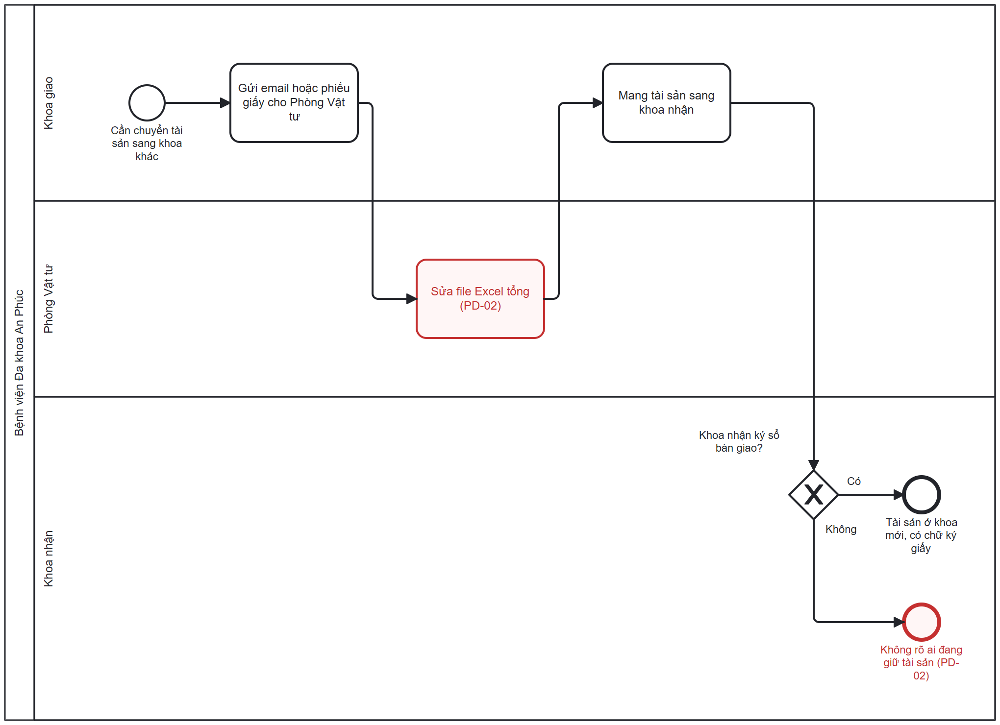
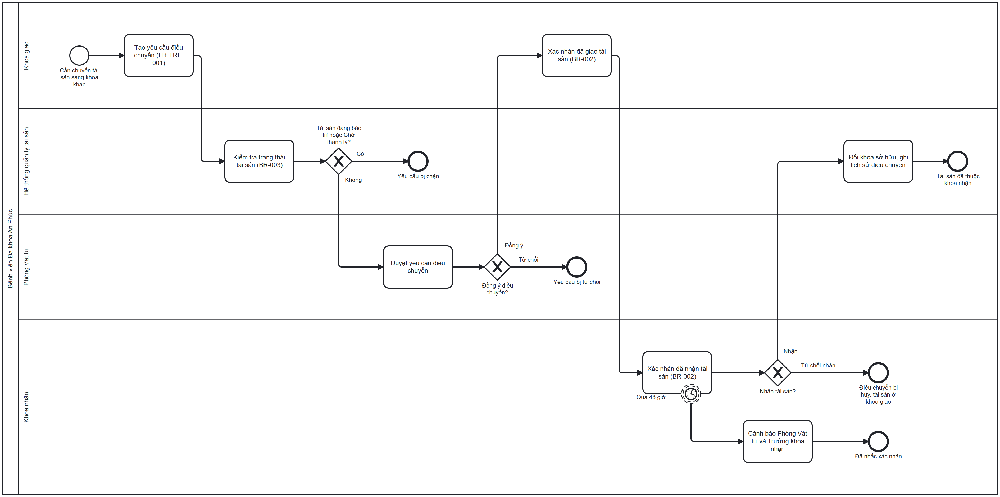
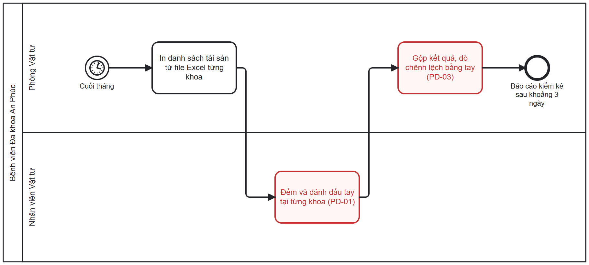
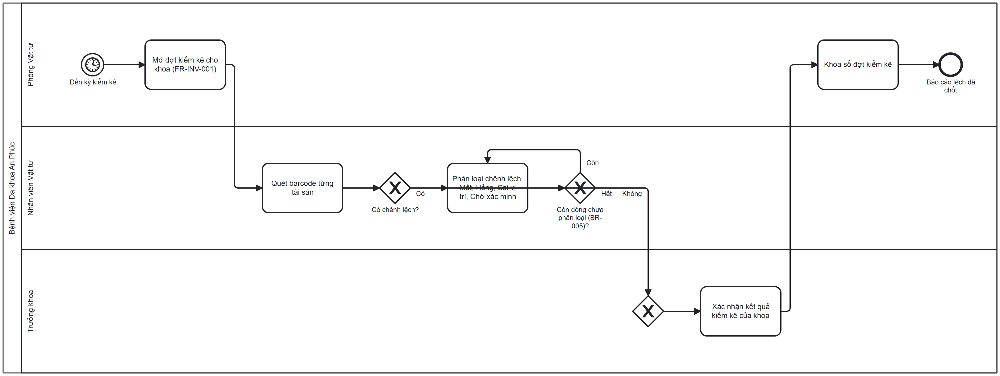
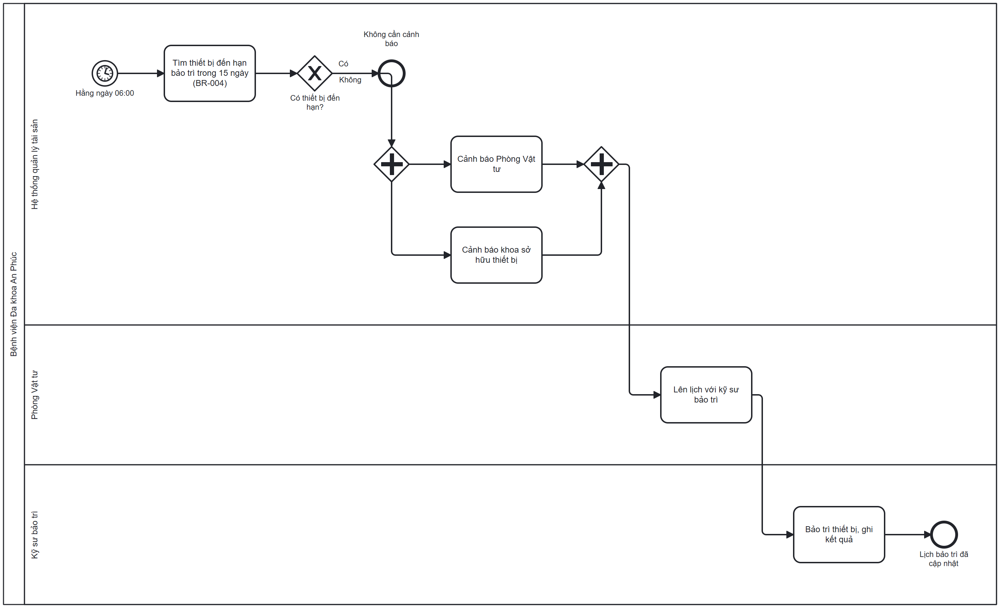

# QUY TRÌNH NGHIỆP VỤ (Hiện tại / Tương lai) — DỰ ÁN OUTSOURCE
# Dự án: Hệ thống Quản lý Tài sản Bệnh viện

> **Phiên bản:** 1.0 | **Ngày:** 26/02/2026
> **Trạng thái:** Baseline 1.0 — Người đại diện KH đã ký mục 6 ngày 26/02/2026
> **Người chịu trách nhiệm:** Nguyễn Văn A — BA Lead
> **Nguồn:** workshop Phòng Vật tư 20/02/2026 (SRC-01), phỏng vấn kỹ sư thiết bị (SRC-03), buổi duyệt BRD 26/02/2026 (SRC-04) — xem `02-BRD.md` mục 5.2
> **Nhãn:** [TÀI LIỆU MẪU] — ví dụ minh họa cấu trúc, không phải dự án thật
> **Quy ước vẽ:** BPMN 2.0 theo `so_do.md` mục 4. Mỗi quy trình có file nguồn `diagrams/<tên>.bpmn` (bản chuẩn, mở bằng bpmn.io / Camunda Modeler), file mô tả `diagrams/<tên>.json` để sinh lại, và ảnh `diagrams/<tên>.png` chèn trong tài liệu.

---

## 1. Cách thu thập quy trình khi làm gia công

| Yếu tố | Nội bộ | Gia công |
|---------|--------|----------|
| Nguồn thông tin | Ngồi cạnh người dùng, quan sát | Phỏng vấn từ xa, chia sẻ màn hình, ghi hình |
| Xác nhận | Đi thực tế | Gọi video, ghi màn hình, khách hàng xác nhận qua email |
| Phê duyệt | Không chính thức | **Chính thức**: khách hàng ký quy trình trước khi đội phát triển bắt đầu (mục 6) |
| Thay đổi | Cập nhật luôn | Yêu cầu thay đổi (CR) nếu ảnh hưởng phạm vi hoặc khối lượng |

---

## 2. Danh sách quy trình

| # | Quy trình | Yêu cầu liên quan | Ưu tiên | Trạng thái | Khách hàng duyệt |
|---|-----------|-------------------|---------|-----------|------------------|
| P1 | Điều chuyển tài sản giữa các khoa | BRQ-04, BR-002, BR-003, FR-TRF-001, FR-TRF-002 | P0 | Baseline 1.0 | Đã ký 26/02/2026 |
| P2 | Kiểm kê theo đợt | BRQ-05, BRQ-06, BR-005, FR-INV-001 | P0 | Baseline 1.0 | Đã ký 26/02/2026 |
| P3 | Cảnh báo và lên lịch bảo trì | BRQ-07, BRQ-08, BR-004 | P0 | Baseline 1.0 | Đã ký 26/02/2026 |

Đọc sơ đồ: mỗi làn (lane) là một vai trò, bước nằm trong làn nào thì vai trò đó làm (làn "Hệ thống quản lý tài sản" là bước tự động); hình thoi chữ X là rẽ nhánh một đường, dấu + là làm song song; vòng tròn có đồng hồ là chờ thời gian; vòng tròn viền đậm là kết thúc. Ô viền đỏ trong sơ đồ As-Is là bước gây điểm đau.

---

## 3. P1 — Điều chuyển tài sản giữa các khoa

### 3.1. Hiện tại (As-Is)

Bản chuẩn BPMN 2.0: [`diagrams/p1-dieu-chuyen-asis.bpmn`](diagrams/p1-dieu-chuyen-asis.bpmn), mở và sửa bằng bpmn.io hoặc Camunda Modeler. Sinh lại (chạy trong thư mục bộ tài liệu): `python ../scripts/bpmn_tool.py build diagrams/p1-dieu-chuyen-asis.json --png diagrams/p1-dieu-chuyen-asis.png`. Ô viền đỏ là bước gây điểm đau.

| Mã | Điểm đau | Mức | Nguồn |
|---|---|---|---|
| PD-02 | Điều chuyển không có luồng xác nhận chuẩn; file Excel và thực tế lệch nhau | 🟠 Cao | SRC-01 · E2 (`02-BRD.md` mục 6.1) |

### 3.2. Tương lai (To-Be)

Bản chuẩn BPMN 2.0: [`diagrams/p1-dieu-chuyen-tobe.bpmn`](diagrams/p1-dieu-chuyen-tobe.bpmn), mở và sửa bằng bpmn.io hoặc Camunda Modeler. Sinh lại (chạy trong thư mục bộ tài liệu): `python ../scripts/bpmn_tool.py build diagrams/p1-dieu-chuyen-tobe.json --png diagrams/p1-dieu-chuyen-tobe.png`.

**Cải tiến:** mỗi lần điều chuyển có người yêu cầu, người duyệt, người giao, người nhận và thời điểm hoàn tất (BRQ-04); khoa sở hữu chỉ đổi sau xác nhận thứ hai (BR-002).

---

## 4. P2 — Kiểm kê theo đợt

### 4.1. Hiện tại (As-Is)

Bản chuẩn BPMN 2.0: [`diagrams/p2-kiem-ke-asis.bpmn`](diagrams/p2-kiem-ke-asis.bpmn), mở và sửa bằng bpmn.io hoặc Camunda Modeler. Sinh lại (chạy trong thư mục bộ tài liệu): `python ../scripts/bpmn_tool.py build diagrams/p2-kiem-ke-asis.json --png diagrams/p2-kiem-ke-asis.png`. Ô viền đỏ là bước gây điểm đau.

| Mã | Điểm đau | Mức | Nguồn |
|---|---|---|---|
| PD-01 | Không có mã duy nhất; một tài sản có nhiều tên, đếm trùng hoặc sót | 🔴 Nghiêm trọng | SRC-01 · E2, SRC-02 · E4 |
| PD-03 | Gộp file từ nhiều khoa mất khoảng 3 ngày công mỗi tháng | 🟡 Trung bình | SRC-02 · E4 |

### 4.2. Tương lai (To-Be)

Bản chuẩn BPMN 2.0: [`diagrams/p2-kiem-ke-tobe.bpmn`](diagrams/p2-kiem-ke-tobe.bpmn), mở và sửa bằng bpmn.io hoặc Camunda Modeler. Sinh lại (chạy trong thư mục bộ tài liệu): `python ../scripts/bpmn_tool.py build diagrams/p2-kiem-ke-tobe.json --png diagrams/p2-kiem-ke-tobe.png`.

**Cải tiến:** kiểm kê tháng từ khoảng 3 ngày xuống 1 ngày (`02-BRD.md` mục 6.2); không chốt đợt khi còn chênh lệch chưa phân loại (BR-005).

---

## 5. P3 — Cảnh báo và lên lịch bảo trì (To-Be)

As-Is: không có lịch bảo trì tập trung; kỹ sư thiết bị nhớ hạn theo sổ riêng (SRC-03). Không vẽ sơ đồ As-Is vì không có quy trình chung để vẽ.

Bản chuẩn BPMN 2.0: [`diagrams/p3-bao-tri-tobe.bpmn`](diagrams/p3-bao-tri-tobe.bpmn), mở và sửa bằng bpmn.io hoặc Camunda Modeler. Sinh lại (chạy trong thư mục bộ tài liệu): `python ../scripts/bpmn_tool.py build diagrams/p3-bao-tri-tobe.json --png diagrams/p3-bao-tri-tobe.png`.

---

## 6. Phân tích khoảng cách

| # | Lĩnh vực | Hiện tại | Tương lai | Khoảng cách | Giải pháp | Trong phạm vi? |
|---|----------|----------|-----------|-------------|-----------|---------------|
| 1 | Định danh tài sản | Tên tự do trong Excel | Mã duy nhất và barcode | Không có mã chung | BRQ-01, BRQ-02, BR-001 | ✅ Có |
| 2 | Điều chuyển | Email, sổ giấy | Yêu cầu, duyệt, hai bên xác nhận | Không có bằng chứng bàn giao | P1, BR-002 | ✅ Có |
| 3 | Kiểm kê | Đếm tay, gộp file | Quét barcode, phân loại lệch | Mất 3 ngày công, khó truy trách nhiệm | P2, BR-005 | ✅ Có |
| 4 | Bảo trì | Sổ riêng của kỹ sư | Lịch tập trung, cảnh báo trước 15 ngày | Không ai thấy hạn chung | P3, BR-004 | ✅ Có |
| 5 | Tích hợp ERP kế toán | Kế toán nhập tay | Đồng bộ tự động | Chưa có kết nối | Ngoài phạm vi giai đoạn 1 (`02-BRD.md` mục 4.3) | ❌ Cần CR |

> **Lưu ý outsource:** khoảng cách nằm ngoài phạm vi hợp đồng ghi "Cần CR" và được ước lượng chi phí trước khi cam kết.

---

## 7. Phê duyệt quy trình

| Quy trình | Phiên bản | Người đại diện KH (PO) | Ngày | Ghi chú |
|-----------|-----------|--------------------------|------|---------|
| P1: Điều chuyển tài sản | 1.0 | Phạm Thu Hà — Trưởng phòng Vật tư (đã ký) | 26/02/2026 | Ký cùng BRD |
| P2: Kiểm kê theo đợt | 1.0 | Phạm Thu Hà — Trưởng phòng Vật tư (đã ký) | 26/02/2026 | Ký cùng BRD |
| P3: Cảnh báo bảo trì | 1.0 | Phạm Thu Hà — Trưởng phòng Vật tư (đã ký) | 26/02/2026 | Kỹ sư thiết bị đã xem trước (SRC-03) |

> Tên người ký là dữ liệu minh họa của tài liệu mẫu. **Sau khi phê duyệt**, quy trình là baseline; mọi thay đổi đi qua Yêu cầu thay đổi (CR).
