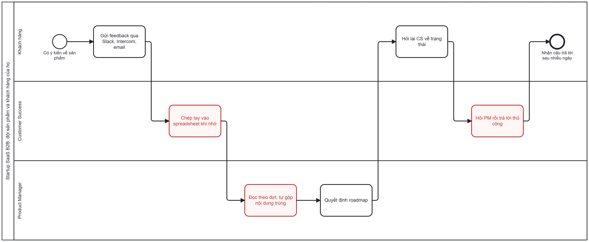
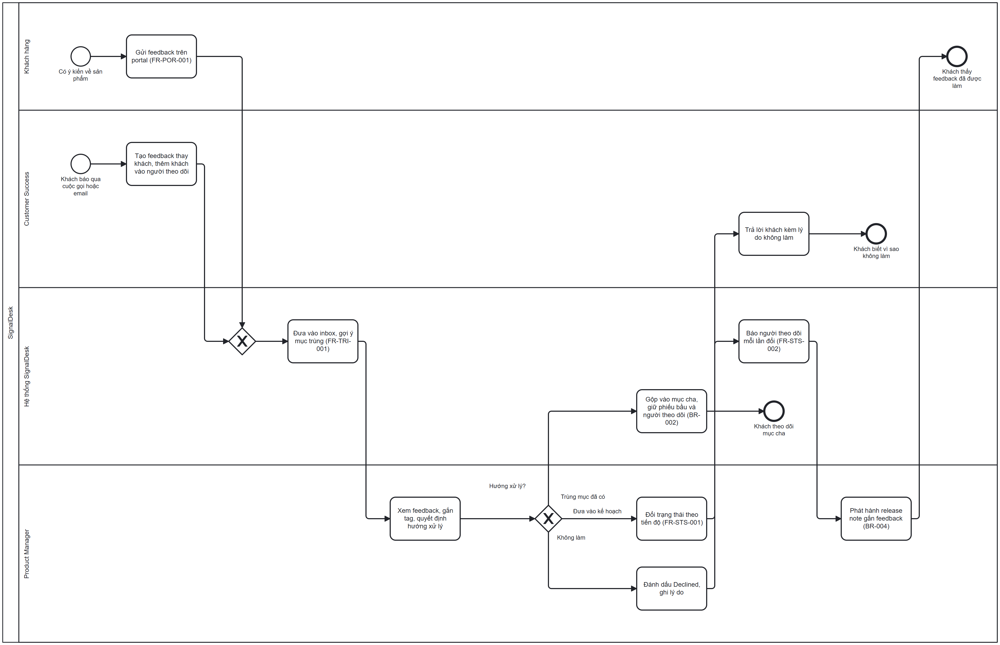

# TÀI LIỆU YÊU CẦU NGHIỆP VỤ (BRD)
# Epic: Feedback Portal & Triage Loop

> **Phiên bản:** 0.2 | **Ngày:** 12/05/2026
> **Product:** SignalDesk | **Trạng thái:** Trình duyệt (chưa ký; còn 1 nhận định trọng yếu chờ nguồn trực tiếp)
> **Người chịu trách nhiệm:** PM/BA của epic
> **Tham chiếu:** `01-Vision-Scope.md` bản 1.0 (Draft 12/05/2026, chưa ký)
> **Tier:** 2 — điểm rủi ro 2/7 (câu 6, 7): hai PM có thể merge cùng một feedback và merge khó đảo ngược; email thông báo và release note công khai đã gửi ra ngoài thì không thu hồi được
> **Nhãn:** [TÀI LIỆU MẪU] — ví dụ minh họa cấu trúc, không phải dự án thật

---

## 1. Vấn đề cần giải quyết

> **Vấn đề người dùng gặp phải:**
> Đội Product Manager và Customer Success đang thu feedback từ nhiều nguồn nhưng không có một luồng chung để biến feedback thành quyết định trên roadmap.

> **Bằng chứng / Số liệu:** mỗi dòng dưới đây ghi nguồn và mức bằng chứng; Sổ nguồn ở mục 8.

### 1.1. Vấn đề hiện tại

| # | Vấn đề hiện tại | Ảnh hưởng | Mức độ | Nguồn · Mức |
|---|----------------------|-----------|--------|-------------|
| 1 | 43% feedback mới đang nằm trong Slack hoặc email, không vào backlog | PM không thấy toàn cảnh nhu cầu khách hàng | 🔴 Cao | SRC-02 · E3 |
| 2 | 31% khách hàng beta nói họ không biết request của mình đang ở trạng thái nào | CS mất thời gian trả lời thủ công | 🟠 Cao | SRC-01 · E2, gián tiếp (PM/CS thuật lại) — `[CẦN XÁC NHẬN: hỏi trực tiếp khách hàng beta trong khảo sát tuần 2, PO]` |
| 3 | 22% feedback bị trùng nội dung nhưng không được gộp | Roadmap bị nhiễu, số phiếu bầu không đáng tin | 🟠 Cao | SRC-02 · E3 |

### 1.2. Thuật ngữ

| Thuật ngữ | Giải thích |
|---|---|
| Feedback item (mục feedback) | Một yêu cầu hoặc phản hồi từ người dùng cuối |
| Subscriber (người theo dõi) | Người theo dõi một mục feedback để nhận thông báo khi mục đổi trạng thái |
| Merge (gộp) | Gộp feedback trùng vào một mục cha (parent item) |
| Declined | Trạng thái nội bộ khi PM quyết định không làm; portal không hiển thị (BR-003) |
| Release note | Bản ghi công khai mô tả tính năng đã phát hành |

---

## 2. Nhóm người dùng mục tiêu

| Nhóm người dùng | Đặc điểm | Nhu cầu | Khó khăn / Nỗi đau | Mục tiêu |
|-----------------|----------|---------|---------------------|----------|
| Product Manager | Quản lý roadmap cho 1-3 squad | Thấy feedback theo chủ đề và mức ưu tiên | Feedback rải rác, khó bảo vệ quyết định roadmap | Xếp ưu tiên dựa trên số liệu |
| CS Lead | Tiếp xúc khách hàng mỗi ngày | Trả lời khách hàng kèm trạng thái mới nhất | Không biết PM đã xử lý feedback chưa | Bớt việc hỏi lại PM và trả lời khách thủ công |
| Người dùng cuối / Customer Champion | Người dùng thành thạo trong công ty khách hàng | Gửi yêu cầu, bình chọn, theo dõi tiến độ | Không có kênh rõ ràng, gửi rồi “mất hút” | Được phản hồi rõ ràng |

---

## 3. Chỉ tiêu đo lường thành công (OKRs)

| Mục tiêu | Kết quả then chốt | Chỉ tiêu | Hiện tại | Công cụ đo |
|----------|--------------------|----------|----------|------------|
| O1: Kích hoạt quy trình xử lý feedback | KR1: 55% workspace mới công khai portal trong 14 ngày | 55% | 0% | Mixpanel |
| | KR2: 60% feedback mới có trạng thái trong 7 ngày (cùng chỉ tiêu với `01-Vision-Scope.md` O2-KR2) | 60% | 0% | Mixpanel |
| O2: Giảm số lần khách hỏi trạng thái qua support | KR3: 30% ticket hỏi trạng thái chuyển sang khách tự xem trên portal | 30% | 0% | Zendesk + Mixpanel |
| O3: Cho thấy giá trị của gói Pro | KR4: 8% workspace free dùng tính năng thông báo nâng cấp Pro trong 60 ngày | 8% | 0% | Stripe |

---

## 4. Giải pháp đề xuất

### 4.1. Mô tả giải pháp
SignalDesk cung cấp public feedback portal cho khách hàng gửi request và upvote. Team nội bộ nhìn thấy feedback trong inbox chung, được gợi ý feedback trùng, gắn tag, đổi status, và publish release notes khi hoàn thành.

### 4.2. Luồng thao tác người dùng
> Chi tiết tại `04-User-Flow.md`

#### 4.2.1. Quy trình hiện tại (As-Is)

Bản chuẩn BPMN 2.0: [`diagrams/feedback-asis.bpmn`](diagrams/feedback-asis.bpmn), mở và sửa bằng bpmn.io hoặc Camunda Modeler. Ô viền đỏ là bước gây điểm nghẽn.

<!-- Sinh lại ảnh (chạy trong thư mục bộ tài liệu): python ../scripts/bpmn_tool.py build diagrams/feedback-asis.json --png diagrams/feedback-asis.png -->

| Bước | Ai làm | Điểm nghẽn (số liệu ở mục 1.1) |
|---|---|---|
| Thu feedback | Khách hàng, CS | 43% feedback mới nằm lại ở Slack/email, không vào backlog |
| Gộp nội dung trùng | PM | 22% feedback trùng nhưng không được gộp, vote count không đáng tin |
| Báo trạng thái | CS | 31% khách hàng beta không biết request đang ở trạng thái nào |

Chưa có quy trình hiện tại thống nhất giữa PM và CS; mỗi team giữ nguồn riêng. Sơ đồ As-Is vẽ quy trình tại công ty khách hàng (startup SaaS B2B) trước khi có SignalDesk.

#### 4.2.2. Quy trình đề xuất (To-Be)

Bản chuẩn BPMN 2.0: [`diagrams/feedback-tobe.bpmn`](diagrams/feedback-tobe.bpmn), mở và sửa bằng bpmn.io hoặc Camunda Modeler.

<!-- Sinh lại ảnh (chạy trong thư mục bộ tài liệu): python ../scripts/bpmn_tool.py build diagrams/feedback-tobe.json --png diagrams/feedback-tobe.png -->

Đọc sơ đồ: feedback vào inbox từ hai nguồn, khách tự gửi trên portal hoặc CS tạo thay khách sau cuộc gọi, email và thêm khách vào danh sách theo dõi. Hệ thống gợi ý mục trùng (FR-TRI-001); PM chọn một trong ba hướng. Gộp vào mục cha thì hệ thống chuyển phiếu bầu, người theo dõi, lịch sử (BR-002). Không làm thì mục chuyển `Declined`, CS trả lời khách kèm lý do. Đưa vào kế hoạch thì mỗi lần PM đổi sang trạng thái công khai, hệ thống báo người theo dõi (BR-003); khi tính năng ra mắt, PM phát hành release note gắn feedback (BR-004). Người bình chọn một mục có sẵn không tạo mục mới nên không quay lại bước phân loại của PM (`04-User-Flow.md` mục 1.2).

### 4.3. Giao diện phác thảo
> Link Figma: Figma / SignalDesk Beta / Portal-v5 (bản màu của đội thiết kế). Wireframe chốt hành vi của portal (SCR-01) và hộp thư phân loại (SCR-02) nằm ở `05-SRS-Lite.md` mục 2.7.

---

## 5. Yêu cầu nghiệp vụ (Business Requirements)

### 5.1. Yêu cầu chức năng

| Mã | Yêu cầu nghiệp vụ | Mô tả | Bên liên quan |
|----|-------------------|-------|---------------|
| BRQ-01 | Public portal nhận feedback | Khách hàng có thể gửi feedback và xem status của feedback đã gửi | End User, PM |
| BRQ-02 | Feedback trùng phải được gợi ý merge | PM phải thấy candidate duplicates để tránh vote bị phân mảnh | PM |
| BRQ-03 | Status update phải phản hồi lại cho người theo dõi | Khi PM đổi status, subscriber phải được thông báo | PM, CS Lead |
| BRQ-04 | Release notes phải nối với feedback đã ship | Product team cần chứng minh “feedback -> delivered value” | PM, Founder |
| BRQ-05 | Portal phải đo activation và engagement | Mọi luồng chính phải phát analytics events để đo activation | PM, Growth |

### 5.2. Quy tắc nghiệp vụ (Business Rules)

| Mã | Quy tắc | Áp dụng cho | Nguồn · Mức |
|----|---------|-------------|-------------|
| BR-001 | Một user chỉ được upvote một feedback item một lần trong cùng workspace | Portal | SRC-01, SRC-03 · E2 |
| BR-002 | Merge feedback không được mất vote count, subscriber list, hay audit history | Triage | SRC-01 · E2 |
| BR-003 | Chỉ feedback ở trạng thái `Planned`, `In Progress`, `Released` mới được hiển thị status công khai | Portal | SRC-04 · E1 (quyết định của PO) |
| BR-004 | Release note chỉ hiển thị public sau `publish_at` | Changelog | SRC-04 · E1 (quyết định của PO) |
| BR-005 | Mọi transition status phải ghi event analytics và audit log | Triage / Analytics | SRC-04 · E1 (quyết định của PO) |

> Mỗi BR được thực thi bởi ít nhất một FR và kiểm chứng bởi ít nhất một kịch bản TC. Ma trận BR → FR → TC: xem `05-SRS-Lite.md` Mục 2.6.

### 5.3. Business Rule Architecture

- **Execution order:** submit feedback -> deduplicate review -> status assignment -> subscriber notification -> release note publication.
- **Override matrix:** chỉ Admin hoặc Product Manager mới được merge feedback hoặc đổi trạng thái public-facing.
- **Decision owner:** Product Lead quyết định status model; Growth Lead quyết định event taxonomy; CS Lead được consult về subscriber messaging.

### 5.4. Giả định & Ràng buộc

| Loại | Nội dung | Ảnh hưởng nếu sai |
|---|---|---|
| Assumption | Workspace có ít nhất 1 PM willing to maintain status hằng tuần | Portal thành “dead board”, mất trust |
| Assumption | Người dùng cuối chấp nhận đăng nhập magic-link hoặc email verify để theo dõi feedback | Adoption portal thấp |
| Constraint | MVP không hỗ trợ SSO cho end-user portal | Enterprise onboarding chưa support ngay |
| Constraint | Không làm AI auto-prioritization ở phase này | PM vẫn phải quyết định priority thủ công |
| Constraint | Chỉ support 1 portal public / workspace ở MVP | Hạn chế multi-brand use case |

---

## 6. Phạm vi tính năng (Phân loại ưu tiên)

### ✅ BẮT BUỘC (Must)

| ID | Tính năng | Mô tả nhu cầu | Phân loại giá trị | Giai đoạn |
|----|-----------|---------------|-------------------|----------|
| F01 | Public feedback portal | Khách hàng gửi feedback và xem trạng thái | Nâng cao (Performance) | GĐ1 |
| F02 | Feedback inbox & triage | PM xem feedback, tag, đổi status | Nâng cao (Performance) | GĐ1 |
| F03 | Duplicate merge | PM gộp feedback trùng và giữ vote/history | Nâng cao (Performance) | GĐ1 |

### 🟡 NÊN CÓ (Should)

| ID | Tính năng | Mô tả nhu cầu | Phân loại giá trị | Giai đoạn |
|----|-----------|---------------|-------------------|----------|
| F04 | Status notification | Subscriber nhận email khi feedback đổi trạng thái | Gây ấn tượng (Attractive) | GĐ2 |
| F05 | Release notes feed | PM publish changelog gắn với delivered feedback | Gây ấn tượng (Attractive) | GĐ2 |

### 🔵 CÓ THỂ (Could)

| ID | Tính năng | Mô tả nhu cầu | Phân loại giá trị | Giai đoạn |
|----|-----------|---------------|-------------------|----------|
| F06 | Saved filters | PM lưu view theo tag/status | Gây ấn tượng (Attractive) | GĐ3+ |

### ❌ CHƯA LÀM (Won't)

| Feature | Lý do | Xem xét lại |
|---------|-------|-------------|
| AI auto-prioritization | Chưa đủ dữ liệu và trust threshold | Sau 2 quý usage |

---

## 7. Ngoài phạm vi

- Multi-workspace consolidated analytics
- Native mobile app
- White-label portal full custom domain

---

## 8. Phụ thuộc & Giả định

### Phụ thuộc (Dependencies)

| # | Phụ thuộc vào | Đội / Dịch vụ | Trạng thái |
|---|-----------|-------------|--------|
| 1 | Email delivery service | Platform | Ready |
| 2 | Event pipeline vào Mixpanel | Data | Planned |
| 3 | Release note editor basic | Frontend | In progress |

### Elicitation Record

- 12 cuộc phỏng vấn với PM và CS leads tại startup SaaS 10-80 nhân sự.
- 37 đoạn hội thoại support được audit để phân loại feedback requests.
- 3 prototype tests cho portal public và feedback inbox.

### Sổ nguồn (Source Register)

| Mã nguồn | Loại | Người / đơn vị | Vai trò stakeholder | Trực tiếp / Gián tiếp | Ngày | Ghi chú |
|---|---|---|---|---|---|---|
| SRC-01 | Phỏng vấn (12 buổi) | PM và CS lead tại startup SaaS 10–80 nhân sự | Direct User | Trực tiếp với nỗi đau của PM/CS; gián tiếp với trải nghiệm của khách hàng cuối | 05/2026 | Ghi chú phỏng vấn trong thư mục discovery |
| SRC-02 | Audit dữ liệu | 37 hội thoại support | — | Trực tiếp (E3, mẫu nhỏ) | 05/2026 | Nguồn của tỷ lệ 43% và 22% |
| SRC-03 | Prototype test (3 buổi) | End User / Customer Champion | Direct User | Trực tiếp (E3, mẫu nhỏ) | 05/2026 | Portal public và feedback inbox |
| SRC-04 | Quyết định sản phẩm | Product Owner | Người quyết định phạm vi | Trực tiếp | 12/05/2026 | Duyệt bản 1.0 |

**Nhận định trọng yếu còn thiếu nguồn trực tiếp:** tỷ lệ 31% khách hàng không biết trạng thái request (mục 1.1, dòng 2) đang dựa trên lời PM/CS thuật lại. Nhận định này không dùng làm baseline KPI; PO xác nhận bằng khảo sát khách hàng beta tuần 2 (`08-Beta-Testing-Plan.md` mục 3.2).

### System Memory / Historical Data

- Merge feedback phải giữ full history của parent/child item.
- Status timeline của feedback phải xem lại được để CS giải thích với khách hàng.
- Release notes cần nối với feedback đã tồn tại từ các sprint trước.

---

## 9. Rủi ro & Giải pháp giảm thiểu

| # | Rủi ro | Xác suất | Mức ảnh hưởng | Giải pháp giảm thiểu |
|---|--------|----------|---------------|----------------------|
| 1 | PM không maintain status đều đặn | Cao | Cao | Weekly digest + owner reminder |
| 2 | Merge suggestion false positive | Trung bình | Cao | Manual review only, không auto merge |
| 3 | Portal bị spam | Trung bình | Trung bình | Rate limit + email verify |
| 4 | Notification gây noise | Trung bình | Cao | Cho subscribe/unsubscribe theo item |

---

## 10. Câu hỏi chưa có lời đáp

| # | Câu hỏi | Phụ trách | Hạn trả lời | Đáp án |
|---|---------|-----------|-------------|--------|
| 1 | Có cần custom status per workspace trong MVP không? | Product Lead | 20/05/2026 | |
| 2 | Có cho anonymous feedback submit không? | PM + Legal | 22/05/2026 | |
| 3 | Có công khai trạng thái `Declined` và báo người theo dõi không? Theo BR-003 hiện tại thì không; CS trả lời từng khách | Product Lead + CS Lead | 22/05/2026 | |

---

## 11. Kế hoạch Phát hành & Triển khai

| Giai đoạn | % Người dùng | Thời gian | Tiêu chí chuyển tiếp |
|-----------|-------------|-----------|----------------------|
| Kiểm thử nội bộ | Chỉ đội ngũ | 1 tuần | 0 lỗi nghiêm trọng |
| Thử nghiệm kín (Beta) | 5% workspace | 2 tuần | Activation ≥ 45%, 0 critical issue |
| Thử nghiệm mở | 20% workspace | 1 tuần | Metrics ổn định, spam rate thấp |
| Ra mắt chính thức | 100% người dùng | — | Đạt KR activation chính |

---

## 12. Ma trận truy vết (RTM — Requirement Traceability Matrix)

| Goal Ref | BRQ | FR/NFR | Tính năng | Story | Test / Beta |
|----------|-----|--------|-----------|-------|-------------|
| O1-KR1 | BRQ-01 | FR-POR-001 | F01 | US-POR-001 | TC-POR-001, IT-001 |
| O1-KR1 | BRQ-01 | FR-POR-002 | F01 | US-POR-002 | TC-POR-002, IT-002 |
| O1-KR2 | BRQ-02 | FR-TRI-001 | F02 | US-TRI-001 | TC-TRI-001 |
| O2-KR3 | BRQ-02 | FR-TRI-002 | F03 | US-TRI-002 | TC-TRI-002, IT-003 |
| O2-KR3 | BRQ-03 | FR-STS-001 | F04 | US-STS-001 | TC-STS-001, TC-STS-002, IT-004 |
| O2-KR3 | BRQ-03 | FR-STS-002 | F04 | US-STS-001 | TC-STS-001 |
| O3-KR4 | BRQ-04, BRQ-05 | FR-REL-001 | F05 | US-REL-001 | TC-REL-001, IT-005 |
| O3-KR4 | BRQ-05 | NFR-EVT-001 | — | — | TC-NFR-001 |

> `IT-xxx` là mã kiểm thử nội bộ của QA (`08-Beta-Testing-Plan.md` Mục 2.2), không thuộc chuỗi canonical; kịch bản nghiệm thu dùng `TC-<MODULE>-xxx`.

---

## 13. Phê duyệt

| Vai trò | Họ tên | Chữ ký | Ngày |
|---------|--------|--------|------|
| Product Lead | | | |
| PM / BA | | | |

> **Quy tắc:** Sau khi phê duyệt, mọi thay đổi yêu cầu phải qua quy trình Yêu cầu Thay đổi (CR) — xem `09-Release-Notes.md`

---

## Lịch sử chỉnh sửa

| Phiên bản | Ngày | Thay đổi | Người |
|-----------|------|----------|-------|
| 0.1 | 05/05/2026 | Draft đầu tiên | PM/BA |
| 0.2 | 12/05/2026 | Trình duyệt cho discovery build; chờ xác nhận số liệu 31% trước khi ký mục 13 | PM/BA |
