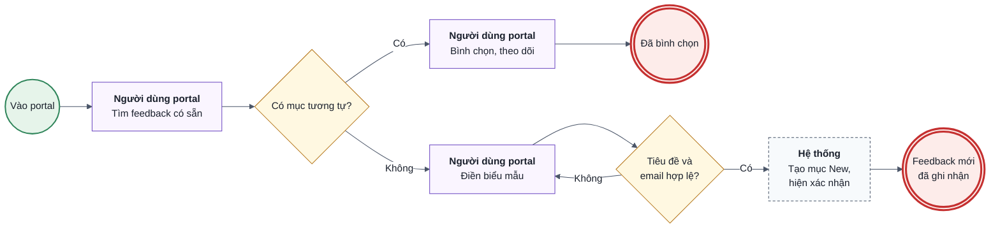

# USER FLOW & JOURNEY MAP
# SignalDesk

> **Phiên bản:** 1.0 | **Ngày:** 13/05/2026
> **Tham chiếu:** `02-BRD.md`, `05-SRS-Lite.md`, `08-Beta-Testing-Plan.md`

---

## 1. Luồng sản phẩm tổng quan

### 1.1. Kích hoạt workspace

```mermaid
%%{init: {"theme": "base", "fontFamily": "Arial, Helvetica, sans-serif", "themeVariables": {"fontSize": "15px", "primaryColor": "#FFFFFF", "primaryBorderColor": "#4A5568", "primaryTextColor": "#1A202C", "lineColor": "#4A5568", "secondaryColor": "#F7FAFC", "tertiaryColor": "#F7FAFC", "clusterBkg": "#F7FAFC", "clusterBorder": "#A0AEC0", "edgeLabelBackground": "#FFFFFF", "actorBkg": "#EBF8FF", "actorBorder": "#2B6CB0", "noteBkgColor": "#FFF8E1", "noteBorderColor": "#B7791F"}}}%%
flowchart LR
    S(("Đăng ký hoặc<br/>nhận lời mời")) -->|"signup_completed"| T1["<b>Admin</b><br/>Tạo workspace"]
    T1 -->|"workspace_created"| T2["<b>Admin</b><br/>Nhập CSV hoặc<br/>dữ liệu mẫu"]
    T2 -->|"feedback_imported"| T3["<b>Admin</b><br/>Công khai portal"]
    T3 -->|"portal_published"| E1((("Có feedback<br/>đầu tiên")))

    classDef startEvt fill:#E6F4EA,stroke:#2F855A,stroke-width:2px
    classDef endEvt fill:#FDECEA,stroke:#C53030,stroke-width:3px
    classDef gateway fill:#FFF8E1,stroke:#B7791F
    classDef sys fill:#F7FAFC,stroke:#4A5568,stroke-dasharray:4 3
    classDef role1 fill:#EBF8FF,stroke:#2B6CB0
    classDef role2 fill:#F0FFF4,stroke:#2F855A
    classDef role3 fill:#FAF5FF,stroke:#6B46C1
    classDef pain fill:#FFF5F5,stroke:#C53030,stroke-dasharray:2 2
    class S startEvt
    class E1 endEvt
    class T1,T2,T3 role1
```

Nhãn trên mũi tên là sự kiện analytics phát ra khi bước trước hoàn tất; sự kiện cuối là `feedback_submitted` hoặc `feedback_imported`.

**Đường kích hoạt mục tiêu**
- `signup_completed` -> `workspace_created` trong cùng session
- `portal_published` trong 14 ngày
- `feedback_submitted` hoặc `feedback_imported` trong 7 ngày đầu

---

### 1.2. Vòng phản hồi feedback

Bản chuẩn BPMN 2.0: [`diagrams/vong-phan-hoi.bpmn`](diagrams/vong-phan-hoi.bpmn), mở và sửa bằng bpmn.io hoặc Camunda Modeler.

<!-- Sinh lại ảnh (chạy trong thư mục bộ tài liệu): python ../scripts/bpmn_tool.py build diagrams/vong-phan-hoi.json --png diagrams/vong-phan-hoi.png -->

Đọc sơ đồ: người bình chọn một mục có sẵn chỉ tăng phiếu và được thêm vào danh sách theo dõi; mục đó không quay lại bước phân loại của PM, người bình chọn nhận email khi mục đổi trạng thái công khai. Feedback mới đi qua PM với ba hướng: gộp vào mục cha (BR-002), không làm (`Declined`, chỉ nội bộ theo BR-003), đưa vào kế hoạch. Mỗi lần PM đổi sang trạng thái công khai, hệ thống gửi một email; giữa hai lần đổi, PM chờ tiến độ của đội phát triển (sự kiện chờ tin hình phong bì) nên không có email lặp.

**Yêu cầu liên quan**
- `BRQ-01` / `FR-POR-001`, `FR-POR-002`
- `BRQ-02` / `FR-TRI-001`, `FR-TRI-002`
- `BRQ-03` / `FR-STS-001`, `FR-STS-002`
- `BRQ-04`, `BRQ-05` / `FR-REL-001`

---

## 2. Hành trình theo persona

### 2.1. Persona: Product Manager

| Giai đoạn | Hành động | Suy nghĩ | Cảm xúc | Touchpoint | Cơ hội cải thiện |
|-----------|----------|---------|--------|------------|-----------------|
| **Thiết lập** | Tạo workspace, nhập feedback cũ | "Mình có gom được backlog cũ đủ nhanh không?" | 😐 Cẩn trọng | Màn hình onboarding workspace | Nhập CSV, dữ liệu mẫu |
| **Mở portal** | Công khai portal | "Liệu khách hàng có chịu dùng portal thay vì email?" | 🙂 Hy vọng | Cài đặt portal | Xem trước portal, đổi logo và màu chính |
| **Phân loại hằng ngày** | Xem inbox feedback và các mục có thể trùng | "Mình cần lọc nhiễu nhanh, không muốn inbox thành bãi rác" | 😊 Tập trung | Inbox, gợi ý mục trùng | Điểm tin cậy, xem trước khi gộp |
| **Cập nhật trạng thái** | Đổi trạng thái, gắn tag | "Trạng thái này có công khai được không?" | 🙂 Cân nhắc | Chi tiết feedback | Ghi rõ trạng thái nào công khai, trạng thái nào nội bộ |
| **Chứng minh đã làm** | Phát hành release note gắn feedback | "Giờ mình có bằng chứng để nói với khách hàng rồi" | 🎉 Tự tin | Release note | Gắn feedback vào release note bằng một cú bấm |

### 2.2. Persona: Customer Success Lead

| Giai đoạn | Hành động | Suy nghĩ | Cảm xúc | Touchpoint | Cơ hội cải thiện |
|-----------|----------|---------|--------|------------|-----------------|
| **Nhận feedback** | Ghi feedback từ cuộc gọi, email của khách | "Mục này đã có chưa?" | 😐 Bận rộn | CRM, ô tìm kiếm trên portal | Tìm nhanh trước khi tạo mới |
| **Đăng ký theo dõi** | Thêm khách vào danh sách theo dõi đúng mục | "Mình muốn khỏi phải theo dõi tay" | 🙂 Thực dụng | Chi tiết feedback / portal | Thêm người theo dõi trong một bước |
| **Theo dõi trạng thái** | Kiểm tra mục đã `Planned` hay `Released` chưa | "Mình trả lời khách ngay được không?" | 😊 Nhẹ đầu | Trạng thái công khai trên portal | Tên trạng thái thống nhất |
| **Chia sẻ release note** | Gửi release note cho khách | "Đây là bằng chứng tốt cho buổi gia hạn hợp đồng, QBR" | 🎉 Hài lòng | Release note | Nội dung gửi khách được ngay |

### 2.3. Persona: Customer Champion

| Giai đoạn | Hành động | Suy nghĩ | Cảm xúc | Touchpoint | Cơ hội cải thiện |
|-----------|----------|---------|--------|------------|-----------------|
| **Khám phá** | Vào portal từ email hoặc trang trợ giúp | "Có ai thực sự đọc feedback ở đây không?" | 😐 Tò mò | Portal công khai | Hiện số người ủng hộ mỗi mục |
| **Đóng góp** | Tìm, bình chọn hoặc gửi feedback | "Mình muốn làm việc này thật nhanh" | 🙂 Tích cực | Ô tìm kiếm, biểu mẫu gửi | Biểu mẫu ngắn, gợi ý mục trùng |
| **Theo dõi** | Theo dõi mục mình quan tâm | "Bao giờ mình biết có cập nhật?" | 🙂 Hy vọng | Nút theo dõi | Nói rõ khi nào sẽ nhận thông báo |
| **Nhận cập nhật** | Mở email trạng thái hoặc release note | "Ồ, họ thực sự làm theo feedback này" | 🎉 Tin tưởng | Email + portal | Liên kết thẳng về mục hoặc changelog |

---

## 3. Luồng thao tác chi tiết

### 3.1. Gửi feedback trên portal

**Sự kiện đo lường**
- `portal_viewed`
- `feedback_search_performed`
- `feedback_submitted`
- `feedback_upvoted`
- `feedback_subscription_created`

### 3.2. Gộp feedback trùng

Bản chuẩn BPMN 2.0: [`diagrams/gop-feedback-trung.bpmn`](diagrams/gop-feedback-trung.bpmn), mở và sửa bằng bpmn.io hoặc Camunda Modeler.

<!-- Sinh lại ảnh (chạy trong thư mục bộ tài liệu): python ../scripts/bpmn_tool.py build diagrams/gop-feedback-trung.json --png diagrams/gop-feedback-trung.png -->

**Điểm kiểm soát**
- Chỉ `Admin` hoặc `PM` được gộp; làn "Product Manager" trong sơ đồ gồm cả Admin vì hai vai trò có cùng quyền gộp (`05-SRS-Lite.md` mục 5).
- Không có mục nào trên ngưỡng điểm thì hệ thống không gợi ý; PM xử lý feedback như mục mới (FR-TRI-001).
- Thiếu quyền hoặc hai mục thuộc hai workspace khác nhau thì hệ thống chặn gộp và nêu lý do (mục 4.2).
- Màn hình xem trước phải hiển thị mục nào là mục cha.

### 3.3. Cập nhật trạng thái và release note

Bản chuẩn BPMN 2.0: [`diagrams/cap-nhat-trang-thai.bpmn`](diagrams/cap-nhat-trang-thai.bpmn), mở và sửa bằng bpmn.io hoặc Camunda Modeler.

<!-- Sinh lại ảnh (chạy trong thư mục bộ tài liệu): python ../scripts/bpmn_tool.py build diagrams/cap-nhat-trang-thai.json --png diagrams/cap-nhat-trang-thai.png -->

Đọc sơ đồ: mọi lần đổi trạng thái đều lưu lịch sử, audit và sự kiện (BR-005); chỉ `Planned`, `In Progress`, `Released` hiện trên portal và kích hoạt email (BR-003). Mục không có người theo dõi còn đăng ký thì dừng ở bước cập nhật portal (FR-STS-002). Email lỗi được gửi lại tối đa 2 lần sau lần gửi đầu, tức tổng cộng 3 lần gửi; lần thứ 3 vẫn lỗi thì chuyển vào hàng lỗi và cảnh báo đội nội bộ.

Phát hành release note không vẽ sơ đồ riêng vì chỉ một người thao tác trên một màn hình: PM chọn các feedback ở trạng thái `Released`, đặt `publish_at`, phát hành; hệ thống gắn feedback lên portal và phát `release_note_published`. Nếu PM chọn feedback chưa `Released`, hệ thống chặn phát hành (mục 4.3).

---

## 4. Luồng lỗi và trường hợp biên

### 4.1. Lỗi khi gửi trên portal

| Tình huống | Hệ thống xử lý | Người dùng thấy | Ref |
|----------|----------------|-----------|-----|
| Tiêu đề quá ngắn hoặc email sai định dạng | Từ chối, không tạo mục | Báo lỗi ngay dưới ô nhập | `FR-POR-001`, `VR-101` |
| Portal bị spam liên tục | Giới hạn số lần gửi theo IP/email, có thể yêu cầu xác minh email | Thông báo chống spam lịch sự | `NFR-SEC-001` |
| Người dùng gửi mục trùng nội dung | Vẫn cho gửi nhưng gợi ý mục tương tự trước khi gửi | Gợi ý mục trùng trước bước gửi cuối | `BRQ-02` |

### 4.2. Lỗi khi gộp và phân loại

| Tình huống | Hệ thống xử lý | Người dùng thấy | Ref |
|----------|----------------|-----------|-----|
| Người dùng không có quyền gộp | Chặn thao tác, ghi audit | Thông báo thiếu quyền | `FR-TRI-002`, `NFR-SEC-002` |
| Mục cha và mục con thuộc hai workspace khác nhau | Chặn gộp | Thông báo nêu rõ quy tắc tách dữ liệu giữa workspace | `BR-002` |
| Gộp xong thiếu phiếu bầu hoặc người theo dõi | Hủy giao dịch, cảnh báo nội bộ | Admin thấy lỗi | `NFR-AUD-001` |

### 4.3. Lỗi thông báo và release note

| Tình huống | Hệ thống xử lý | Người dùng thấy | Ref |
|----------|----------------|-----------|-----|
| Người theo dõi đã hủy đăng ký | Không gửi, vẫn giữ lịch sử trạng thái | PM không thấy lỗi | `NFR-COMP-001` |
| Dịch vụ email lỗi tạm thời | Gửi lại tối đa 2 lần sau lần gửi đầu (tổng 3 lần), chạy nền | PM thấy trạng thái "đang gửi lại" | `FR-STS-002` |
| PM gắn feedback chưa `Released` vào release note | Chặn phát hành | Thông báo lỗi trước khi phát hành | `FR-REL-001`, `BR-004` |

---

## 5. Luồng thông báo

| Khi nào | Kênh | Nội dung | Thời điểm | Sự kiện |
|---------|---------|----------------|--------|-------|
| Portal được công khai | Trong ứng dụng | Xác nhận workspace đã công khai portal | Ngay lập tức | `portal_published` |
| Có feedback mới | Email hoặc xác nhận trên màn hình | Xác nhận yêu cầu đã ghi nhận | Ngay sau khi gửi | `feedback_submitted` |
| Trạng thái đổi sang `Planned` / `In Progress` / `Released` | Email | Cập nhật tiến độ xử lý | Sau khi đổi trạng thái thành công | `feedback_status_changed` |
| Release note gắn feedback được phát hành | Email + portal | Cho khách thấy tính năng đã phát hành | Sau khi phát hành | `release_note_published` |
| Gửi thông báo lỗi nhiều lần | Cảnh báo nội bộ | Báo đội nội bộ xử lý | Khi lần gửi thứ 3 (lần gửi lại thứ 2) vẫn lỗi | `notification_delivery_failed` |

Trạng thái `New`, `Reviewed`, `Merged`, `Declined` là nội bộ: không hiện trên portal, không gửi email (BR-003).

---

## 6. Chỉ số theo luồng

| Luồng | Chỉ số chính | Chỉ tiêu | Chỉ số phụ |
|------|----------------|--------|--------------------|
| Kích hoạt | Tỷ lệ workspace công khai portal | >= 55% | Thời gian tới feedback đầu tiên, tỷ lệ nhập CSV xong |
| Đóng góp | Tỷ lệ hoàn tất biểu mẫu gửi | >= 60% | Tỷ lệ tìm trước khi gửi, tỷ lệ bình chọn |
| Phân loại | Feedback có trạng thái trong 7 ngày | >= 60% | Tỷ lệ chấp nhận gợi ý gộp |
| Thông báo | Giảm ticket hỏi trạng thái | >= 30% | Tỷ lệ gửi email thành công, tỷ lệ hủy theo dõi |
| Chứng minh giá trị | Release note có gắn feedback | >= 40% số mục đã phát hành | Tỷ lệ bấm từ release note |

---

## 7. Quy ước vẽ luồng

Luồng có nhiều vai trò và rẽ nhánh (mục 1.2, 3.2, 3.3) vẽ bằng BPMN 2.0 (`so_do.md` mục 4): mỗi lane là một vai trò, file nguồn `.bpmn` trong `diagrams/`. Luồng thao tác của một người dùng trên màn hình (mục 1.1, 3.1) là user flow, vẽ bằng Mermaid theo khối khai báo chuẩn (`so_do.md` mục 1.1). Sự kiện analytics ghi trên mũi tên của user flow hoặc trong mục Tracking points.

> Với SignalDesk, mọi flow P0 phải chỉ ra ít nhất một trong ba thứ: `status transition`, `analytics event`, hoặc `customer-facing update`.
