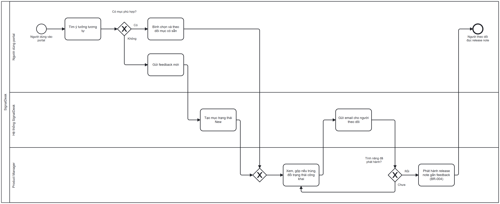
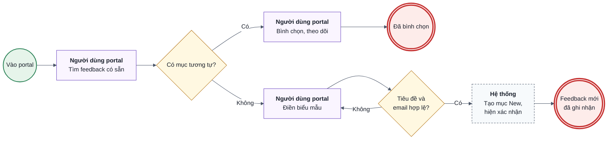
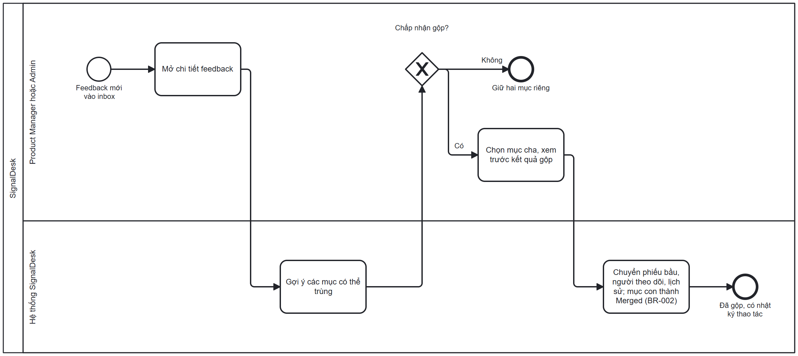
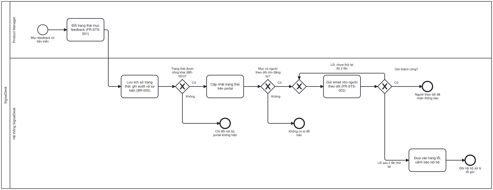

# USER FLOW & JOURNEY MAP
# SignalDesk

> **Phiên bản:** 1.0 | **Ngày:** 13/05/2026
> **Tham chiếu:** `02-BRD.md`, `05-SRS-Lite.md`, `08-Beta-Testing-Plan.md`

---

## 1. High-Level Product Flow

### 1.1. Workspace Activation Flow

```mermaid
%%{init: {"theme": "base", "fontFamily": "Arial, Helvetica, sans-serif", "themeVariables": {"fontSize": "15px", "primaryColor": "#FFFFFF", "primaryBorderColor": "#4A5568", "primaryTextColor": "#1A202C", "lineColor": "#4A5568", "secondaryColor": "#F7FAFC", "tertiaryColor": "#F7FAFC", "clusterBkg": "#F7FAFC", "clusterBorder": "#A0AEC0", "edgeLabelBackground": "#FFFFFF", "actorBkg": "#EBF8FF", "actorBorder": "#2B6CB0", "noteBkgColor": "#FFF8E1", "noteBorderColor": "#B7791F"}}}%%
flowchart LR
    S(("Đăng ký hoặc<br/>nhận lời mời")) -->|"signup_completed"| T1["<b>Admin</b><br/>Tạo workspace"]
    T1 -->|"workspace_created"| T2["<b>Admin</b><br/>Nhập CSV hoặc<br/>dữ liệu mẫu"]
    T2 -->|"feedback_imported"| T3["<b>Admin</b><br/>Công khai portal"]
    T3 -->|"portal_published"| E1((("Có feedback<br/>đầu tiên")))

    classDef startEvt fill:#E6F4EA,stroke:#2F855A,stroke-width:2px
    classDef endEvt fill:#FDECEA,stroke:#C53030,stroke-width:3px
    classDef gateway fill:#FFF8E1,stroke:#B7791F
    classDef sys fill:#F7FAFC,stroke:#4A5568,stroke-dasharray:4 3
    classDef role1 fill:#EBF8FF,stroke:#2B6CB0
    classDef role2 fill:#F0FFF4,stroke:#2F855A
    classDef role3 fill:#FAF5FF,stroke:#6B46C1
    classDef pain fill:#FFF5F5,stroke:#C53030,stroke-dasharray:2 2
    class S startEvt
    class E1 endEvt
    class T1,T2,T3 role1
```

Nhãn trên mũi tên là sự kiện analytics phát ra khi bước trước hoàn tất; sự kiện cuối là `feedback_submitted` hoặc `feedback_imported`.

**Target activation path**
- `signup_completed` -> `workspace_created` trong cùng session
- `portal_published` trong 14 ngày
- `feedback_submitted` hoặc `feedback_imported` trong 7 ngày đầu

---

### 1.2. Core User Flow - Feedback-to-Response Loop

Bản chuẩn BPMN 2.0: [`diagrams/vong-phan-hoi.bpmn`](diagrams/vong-phan-hoi.bpmn), mở và sửa bằng bpmn.io hoặc Camunda Modeler.

<!-- Sinh lại ảnh (chạy trong thư mục bộ tài liệu): python ../scripts/bpmn_tool.py build diagrams/vong-phan-hoi.json --png diagrams/vong-phan-hoi.png -->

**Related requirements**
- `BRQ-01` / `FR-POR-001`, `FR-POR-002`
- `BRQ-02` / `FR-TRI-001`, `FR-TRI-002`
- `BRQ-03` / `FR-STS-001`, `FR-STS-002`
- `BRQ-04`, `BRQ-05` / `FR-REL-001`

---

## 2. Journey Map by Persona

### 2.1. Persona: Product Manager

| Giai đoạn | Hành động | Suy nghĩ | Cảm xúc | Touchpoint | Cơ hội cải thiện |
|-----------|----------|---------|--------|------------|-----------------|
| **Setup** | Tạo workspace, import feedback cũ | "Mình có gom được backlog cũ đủ nhanh không?" | 😐 Cẩn trọng | Workspace onboarding | CSV import + sample data |
| **Portal Launch** | Publish portal public | "Liệu khách hàng có chịu dùng portal thay vì email?" | 🙂 Hy vọng | Portal settings | Portal preview + branding nhẹ |
| **Daily Triage** | Review feedback inbox, xem duplicate candidates | "Mình cần lọc noise nhanh, không muốn inbox thành bãi rác" | 😊 Tập trung | Inbox, duplicate suggestion | Confidence score + merge preview |
| **Status Update** | Đổi status và gắn tag | "Status này có public được không?" | 🙂 Cân nhắc | Feedback detail | Public/private status guardrails |
| **Delivery Proof** | Publish release note linked to feedback | "Giờ mình có bằng chứng để nói với khách hàng rồi" | 🎉 Tự tin | Release notes | One-click link từ feedback sang release |

### 2.2. Persona: Customer Success Lead

| Giai đoạn | Hành động | Suy nghĩ | Cảm xúc | Touchpoint | Cơ hội cải thiện |
|-----------|----------|---------|--------|------------|-----------------|
| **Feedback Intake** | Thu feedback từ customer call/email | "Item này đã tồn tại chưa?" | 😐 Bận rộn | CRM, portal search | Quick search trước khi tạo mới |
| **Subscription** | Subscribe customer vào item đúng | "Mình muốn khỏi phải theo dõi tay" | 🙂 Thực dụng | Feedback detail / portal | Simple subscribe flow |
| **Status Follow-up** | Kiểm tra item đã `Planned` hay `Released` chưa | "Mình có thể trả lời khách hàng ngay không?" | 😊 Nhẹ đầu | Portal public status | Consistent status wording |
| **Release Sharing** | Gửi release note cho customer | "Đây là bằng chứng tốt cho renewal/QBR" | 🎉 Hài lòng | Release notes | Share-ready release copy |

### 2.3. Persona: Customer Champion

| Giai đoạn | Hành động | Suy nghĩ | Cảm xúc | Touchpoint | Cơ hội cải thiện |
|-----------|----------|---------|--------|------------|-----------------|
| **Discover** | Vào portal từ email hoặc help center | "Có ai thực sự đọc feedback ở đây không?" | 😐 Tò mò | Public portal | Social proof, count of supporters |
| **Contribute** | Search, upvote, hoặc submit feedback | "Mình muốn làm việc này thật nhanh" | 🙂 Tích cực | Search, submit form | Fast form, duplicate hint |
| **Track** | Subscribe vào item đã quan tâm | "Bao giờ mình sẽ biết có update?" | 🙂 Hy vọng | Subscribe action | Clear expectation về notification |
| **Receive Update** | Mở email status / release note | "Ồ, họ thực sự làm theo feedback này" | 🎉 Tin tưởng | Email + portal | Direct link về item / changelog |

---

## 3. Detailed Operational Flows

### 3.1. Public Feedback Submission

**Tracking points**
- `portal_viewed`
- `feedback_search_performed`
- `feedback_submitted`
- `feedback_upvoted`
- `feedback_subscription_created`

### 3.2. Duplicate Triage Flow

Bản chuẩn BPMN 2.0: [`diagrams/gop-feedback-trung.bpmn`](diagrams/gop-feedback-trung.bpmn), mở và sửa bằng bpmn.io hoặc Camunda Modeler.

<!-- Sinh lại ảnh (chạy trong thư mục bộ tài liệu): python ../scripts/bpmn_tool.py build diagrams/gop-feedback-trung.json --png diagrams/gop-feedback-trung.png -->

**Control points**
- Chỉ `Admin` hoặc `PM` được merge.
- Không được merge khác workspace.
- Merge preview phải hiển thị item nào là parent.

### 3.3. Status Update and Release Proof Flow

Bản chuẩn BPMN 2.0: [`diagrams/cap-nhat-trang-thai.bpmn`](diagrams/cap-nhat-trang-thai.bpmn), mở và sửa bằng bpmn.io hoặc Camunda Modeler.

<!-- Sinh lại ảnh (chạy trong thư mục bộ tài liệu): python ../scripts/bpmn_tool.py build diagrams/cap-nhat-trang-thai.json --png diagrams/cap-nhat-trang-thai.png -->

Phát hành release note: PM chọn các feedback ở trạng thái `Released`, đặt `publish_at`, phát hành; hệ thống gắn feedback lên portal và phát `release_note_published`. Không có rẽ nhánh nên không vẽ sơ đồ.

---

## 4. Error Flows & Edge Cases

### 4.1. Portal / Submit Errors

| Scenario | Xử lý hệ thống | UX kỳ vọng | Ref |
|----------|----------------|-----------|-----|
| Title quá ngắn hoặc email invalid | Reject request, không tạo item | Inline validation rõ ràng | `FR-POR-001`, `VR-101` |
| Portal bị spam liên tục | Rate-limit theo IP/email, có thể yêu cầu verify | Friendly anti-abuse message | `NFR-SEC-001` |
| User submit item trùng nội dung | Vẫn cho submit nhưng gợi ý item tương tự trước khi gửi | Suggest duplicate before final submit | `BRQ-02` |

### 4.2. Merge / Triage Errors

| Scenario | Xử lý hệ thống | UX kỳ vọng | Ref |
|----------|----------------|-----------|-----|
| User không có quyền merge | Chặn action, ghi audit nếu cần | Permission message rõ | `FR-TRI-002`, `NFR-SEC-002` |
| Chọn parent/child khác workspace | Chặn merge | Message nêu rõ data isolation rule | `BR-002` |
| Merge xong thiếu vote/subscriber | Không commit giao dịch và raise alert | Admin-visible error | `NFR-AUD-001` |

### 4.3. Notification / Release Errors

| Scenario | Xử lý hệ thống | UX kỳ vọng | Ref |
|----------|----------------|-----------|-----|
| Subscriber đã unsubscribe | Skip send, vẫn giữ status history | Không hiện lỗi cho PM | `NFR-COMP-001` |
| Email provider fail tạm thời | Retry async tối đa 2 lần | PM thấy trạng thái pending/retry | `FR-STS-002` |
| PM cố link feedback chưa `Released` vào release note | Block publish | Validation message trước khi publish | `FR-REL-001`, `BR-004` |

---

## 5. Notification Flows

| Trigger | Channel | Message intent | Timing | Event |
|---------|---------|----------------|--------|-------|
| Portal published | In-app | Xác nhận workspace đã public | Ngay lập tức | `portal_published` |
| Feedback submitted | Email or on-screen confirmation | Xác nhận request đã được ghi nhận | Ngay sau submit | `feedback_submitted` |
| Status changed to `Planned` / `In Progress` / `Released` | Email | Cập nhật tiến độ xử lý | Sau khi transition thành công | `feedback_status_changed` |
| Release note published with linked feedback | Email + portal | Chứng minh giá trị đã phát hành | Sau publish | `release_note_published` |
| Notification delivery failed repeatedly | Internal alert | Cảnh báo đội nội bộ xử lý | Sau 2 lần retry fail | `notification_delivery_failed` |

---

## 6. Flow Metrics

| Flow | Primary metric | Target | Supporting metrics |
|------|----------------|--------|--------------------|
| Activation | Portal publish rate | >= 55% | Time-to-first-feedback, CSV import completion |
| Contribution | Submit completion rate | >= 60% | Search-before-submit rate, upvote rate |
| Triage | Feedback with status in 7 days | >= 60% | Duplicate suggestion acceptance rate |
| Communication | Status request ticket reduction | >= 30% | Notification delivery success, unsubscribe rate |
| Value proof | Release note linked feedback usage | >= 40% of shipped items | Click-through from release note |

---

## 7. Flow Documentation Convention

Luồng có nhiều vai trò và rẽ nhánh (mục 1.2, 3.2, 3.3) vẽ bằng BPMN 2.0 (`so_do.md` mục 4): mỗi lane là một vai trò, file nguồn `.bpmn` trong `diagrams/`. Luồng thao tác của một người dùng trên màn hình (mục 1.1, 3.1) là user flow, vẽ bằng Mermaid theo khối khai báo chuẩn (`so_do.md` mục 1.1). Sự kiện analytics ghi trên mũi tên của user flow hoặc trong mục Tracking points.

> Với SignalDesk, mọi flow P0 phải chỉ ra ít nhất một trong ba thứ: `status transition`, `analytics event`, hoặc `customer-facing update`.
