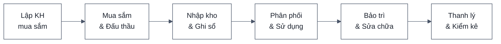

# PROCESS DECOMPOSITION GUIDE — Phân rã Quy trình theo Level (v3.3)

> **Mục đích:** Hướng dẫn BA phân rã quy trình từ tổng quan (L0) đến chi tiết (L3).
> **Vấn đề:** As-Is Process chỉ có 1 level sơ đồ → BA không biết khi nào đã đủ chi tiết.
> **BABOK KA:** Elicitation & Collaboration + Requirements Analysis
> **Phạm vi:** file chủ của định nghĩa L0–L3 và việc chọn level cho từng tài liệu. File khác (ví dụ `templates/bpmn-modeling-standard.md`) trỏ về đây. Cách vẽ sơ đồ theo `so_do.md`: quy trình nghiệp vụ bằng BPMN 2.0 (mục 4), sơ đồ khác bằng Mermaid.

---

## 1. Process Hierarchy — 4 Levels

| Level | Tên | Độ chi tiết | Đối tượng đọc | Ví dụ | Cách thể hiện |
|:-----:|------|-----------|-------------|-------|---------------|
| **L0** | Value Chain | Chuỗi giá trị toàn doanh nghiệp | C-Level, Sponsor | "Mua sắm → Nhập kho → Sử dụng → Thanh lý" | Mermaid flowchart các khối nối tiếp (mục 3.1) |
| **L1** | Process Group | Nhóm quy trình trong 1 domain | PM, PO | "Nhập kho" = Tiếp nhận + Kiểm tra + Ghi sổ + Phân phối | Bảng nhóm quy trình (mục 3.2), hoặc BPMN 2.0 mỗi nhóm một Sub-Process |
| **L2** | Process Detail | Các bước chi tiết trong 1 process | BA, Dev Lead | "Tiếp nhận" = Nhận biên bản → Kiểm hàng → Ký nhận → Nhập hệ thống | BPMN 2.0 có pool/lane (mục 3.3) |
| **L3** | Task/Work Instruction | Hướng dẫn từng thao tác | End User, QC | "Nhập hệ thống" = Mở form → Chọn loại → Điền 8 fields → Nhấn Lưu | Bảng thao tác (mục 3.4) |

---

## 2. Khi nào dùng Level nào?

| Tình huống | Level cần | Tại sao |
|-----------|:---------:|---------|
| Pitch cho Sponsor / Project Charter | L0 | Sponsor chỉ cần big picture |
| BRD — As-Is / To-Be Process | L1 + L2 | PO cần hiểu nhóm process + chi tiết đủ để phát hiện pain points |
| SRS — Use Case / Activity Diagram | L2 + L3 | Dev cần biết chính xác từng bước để code |
| User Story Map — AC | L3 | QC cần biết từng thao tác để test |
| Training Manual / User Guide | L3 | End user cần hướng dẫn step-by-step |

---

## 3. Templates cho Từng Level

### 3.1 L0 — Value Chain Diagram



L0 chỉ có các khối nối tiếp, không cần tô màu. Khi cần màu, chỉ dùng bộ lớp của `so_do.md` mục 1.1, không đặt `style` riêng.

### 3.2 L1 — Process Group Map

```markdown
## Quy trình: Nhập kho & Ghi sổ (L1)

| # | Sub-process | Owner | Trigger | Output |
|---|------------|-------|---------|--------|
| 1.1 | Tiếp nhận hàng hóa | KTTS | Biên bản mua sắm | Biên bản tiếp nhận |
| 1.2 | Kiểm tra chất lượng | QC | Biên bản tiếp nhận | Phiếu kiểm tra |
| 1.3 | Ghi sổ tài sản | Kế toán | Phiếu kiểm tra PASS | Sổ tài sản cập nhật |
| 1.4 | Phân phối về khoa | KTTS | Sổ tài sản | Phiếu xuất kho |
```

### 3.3 L2 — Process Detail (BPMN 2.0)

L2 là sơ đồ quy trình nghiệp vụ, vẽ bằng BPMN 2.0 theo `so_do.md` mục 4: mỗi vai trò một lane, file `diagrams/<tên>.json` → `diagrams/<tên>.bpmn` + `.png` bằng `bpmn_tool.py build`. Cách chèn ảnh và liên kết `.bpmn` vào tài liệu: `so_do.md` mục 4.3. Bản mô tả cho ví dụ "Tiếp nhận và nhập kho":

```json
{
  "id": "nhap_kho_l2", "name": "L2: Tiếp nhận và nhập kho", "pool": "[Tên tổ chức]",
  "lanes": [{"id": "ktts", "name": "Kế toán tài sản"}, {"id": "ke_toan", "name": "Kế toán"}, {"id": "truong_phong", "name": "Trưởng phòng"}],
  "nodes": [
    {"id": "start", "type": "start", "name": "Nhận biên bản mua sắm", "lane": "ktts"},
    {"id": "m1", "type": "xor", "name": "", "lane": "ktts"},
    {"id": "a2", "type": "manual", "name": "Kiểm hàng theo biên bản", "lane": "ktts"},
    {"id": "a3", "type": "manual", "name": "Ký biên bản tiếp nhận", "lane": "ktts"},
    {"id": "b1", "type": "user", "name": "Lập phiếu nhập kho", "lane": "ke_toan"},
    {"id": "b2", "type": "user", "name": "Ghi sổ tài sản", "lane": "ke_toan"},
    {"id": "c1", "type": "user", "name": "Phê duyệt nhập kho", "lane": "truong_phong"},
    {"id": "g1", "type": "xor", "name": "Đồng ý nhập kho?", "lane": "truong_phong"},
    {"id": "b3", "type": "manual", "name": "Dán mã tài sản", "lane": "ke_toan"},
    {"id": "end", "type": "end", "name": "Tài sản đã nhập kho", "lane": "ke_toan"}
  ],
  "flows": [
    ["start", "m1"], ["m1", "a2"], ["a2", "a3"], ["a3", "b1"], ["b1", "b2"], ["b2", "c1"], ["c1", "g1"],
    ["g1", "b3", "Đồng ý"], ["g1", "m1", "Từ chối, kiểm lại"], ["b3", "end"]
  ]
}
```

`m1` là cổng gộp (XOR không tên) vì bước "Kiểm hàng" nhận hai luồng vào: từ đầu quy trình và từ nhánh bị từ chối.

### 3.4 L3 — Task/Work Instruction

```markdown
## Work Instruction: "Ghi sổ tài sản" (L3 — Bước 5 trong L2)

| Step | Action | Input | System | Output | Time |
|:----:|--------|-------|--------|--------|:----:|
| 5.1 | Mở module "Quản lý Tài sản" | Phiếu nhập kho | Click menu → Tài sản → Thêm mới | Form nhập tài sản | 10s |
| 5.2 | Chọn "Loại tài sản" từ dropdown | Thông tin trên phiếu | Dropdown: TSCĐ / CCDC / VTYT | Field "Loại" được fill | 5s |
| 5.3 | Điền thông tin: Tên, Mã, Model, Hãng SX, Giá | Phiếu nhập kho | 8 required fields | Validation real-time | 2 min |
| 5.4 | Upload ảnh tài sản (nếu có) | Camera/file ảnh | Drag & drop, max 5MB, JPG/PNG | Preview thumbnail | 30s |
| 5.5 | Nhấn "Lưu" | — | Validate → Save → Generate Mã TS | Toast "Tạo thành công" + Mã TS | 3s |
| 5.6 | In tem QR tài sản | Mã TS vừa tạo | Button "In QR" → Printer | Tem QR có Mã TS | 15s |
```

---

## 4. Decomposition Rules — Khi nào cần đi sâu thêm 1 level?

| Signal | Action |
|--------|--------|
| 1 bước mất ≥ 30 phút | → Decompose thêm 1 level |
| 1 bước có ≥ 2 người tham gia | → Tách theo actor (mỗi actor một lane) |
| 1 bước có decision point (IF/ELSE) | → Tách thành branches |
| 1 bước có exception handling | → Tách Happy path + Exception |
| Dev nói "chưa hiểu bước này" | → Cần L3 |
| User nói "bước này phức tạp lắm" | → Cần L2 hoặc L3 |

### Quy tắc Dừng (When to STOP decomposing)

| Stop khi... | Lý do |
|-------------|-------|
| Mỗi bước ≤ 5 phút thực hiện | Đủ chi tiết cho Dev |
| Mỗi bước = 1 actor + 1 action + 1 output | Testable |
| Dev xác nhận "hiểu đủ để code" | Đạt mục đích |
| Over-decompose → micro-management | Phản tác dụng |

---

## 5. Áp dụng vào Tài liệu BA

| Tài liệu | Level thường dùng | Khi nào cần deeper |
|-----------|:-----------------:|-------------------|
| **Vision & Scope** | L0 + L1 | Khi Sponsor hỏi "quy trình lớn gì?" |
| **BRD** (As-Is / To-Be) | L1 + L2 | Khi pain point nằm sâu trong L2 |
| **SRS** (Activity Diagram) | L2 + L3 | Khi logic phức tạp, nhiều branching |
| **User Story Map** | L2 → L3 | Khi viết AC cần biết chính xác steps |
| **UAT Plan** | L3 | Test cases cần step-by-step |

---

## 6. Lệnh Kích hoạt

```
@ba-specialist phân rã quy trình [X] từ L0 đến L2
@ba-specialist vẽ sơ đồ BPMN 2.0 L2 cho quy trình [Y]
@ba-specialist viết work instruction L3 cho bước [Z]
@ba-specialist kiểm tra: quy trình này đã đủ chi tiết chưa?
```
