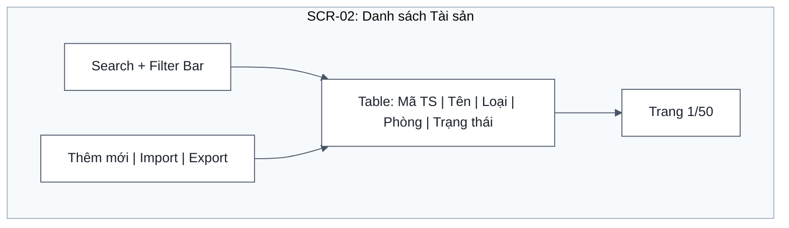

# SCREEN INVENTORY, WIREFRAME & MOCKUP GUIDE

> **Mục đích:** Bảo đảm mỗi Feature có danh sách màn hình (Screen Inventory) và hình ảnh wireframe/mockup rõ ràng trước khi viết SRS chi tiết.
> **Trigger:** Khi lập Screen Inventory, viết SRS mục 2.9 hoặc thiết kế giao diện đầu vào cho Dev/UX/QA.
> **Nguyên tắc:** Không chỉ mô tả màn hình bằng chữ. Màn hình phức tạp phải có ảnh wireframe/mockup kèm liên kết nguồn chỉnh sửa được.

---

## 1. Quy trình Screen Inventory và trực quan hóa

```
Feature nhận được → Liệt kê toàn bộ screens → Gán mục đích, actor, dữ liệu
  → Chọn mức trực quan (Wireframe / Mockup) và công cụ phù hợp (Mục 4)
  → Lưu ảnh PNG vào thư mục wireframes/ và gắn link nguồn (Figma / Stitch / HTML)
  → Review với PO/Dev/UX → Đưa vào SRS mục 2.9 kèm bảng 5 trạng thái trường
```

**Quy tắc:**
- Mỗi Feature (`F01`–`Fxx`) có **≥ 1 screen** (`SCR-01`, `SCR-02`...) trong Screen Inventory.
- Mỗi screen ghi rõ: Mã màn hình, Tên, Mục đích, Actor chính, Dữ liệu hiển thị, Hành động chính.
- Màn hình phức tạp (form > 5 trường, bảng > 5 cột, dashboard, wizard, màn hình bản đồ/báo cáo) **bắt buộc có wireframe hoặc mockup ảnh thật** ở Tier 2–3; Mermaid chỉ dùng phác thảo bố cục nhanh trong lúc trao đổi.

---

## 2. Phân loại Screen Types

| Type | Mô tả | Ví dụ | Cần Wireframe? |
|------|--------|-------|:---:|
| **List/Table** | Hiển thị danh sách dữ liệu với filter/sort/search | Danh sách tài sản, DS nhân viên | ✅ Nếu > 5 cột |
| **Form/Input** | Thu thập dữ liệu từ user | Form tạo tài sản, Đăng ký tài khoản | ✅ Nếu > 5 fields |
| **Detail/View** | Hiển thị chi tiết 1 record | Chi tiết tài sản, Profile user | ✅ Nếu có tabs/sections |
| **Dashboard** | Tổng hợp KPIs, charts, widgets | Dashboard quản lý, Báo cáo tổng hợp | ✅ Luôn luôn |
| **Dialog/Modal** | Popup xác nhận hoặc nhập nhanh | Confirm xóa, Quick edit | ⚠️ Nếu có form bên trong |
| **Wizard/Stepper** | Quy trình nhiều bước | Import Excel, Setup lần đầu | ✅ Luôn luôn |
| **Report/Print** | Layout in ấn hoặc export | Biên bản kiểm kê, Báo cáo xuống cấp | ✅ Luôn luôn |
| **Login/Auth** | Đăng nhập, quên mật khẩu | Login page, Reset password | ⚠️ Nếu custom UI |

---

## 3. Screen Inventory Table Format

```markdown
## Screen Inventory — [Tên Dự Án]

| Screen ID | Tên Screen | Feature | Type | Actor chính | Dữ liệu chính | Wireframe / Mockup |
|---|---|---|---|---|---|---|
| SCR-01 | Dashboard Tổng quan | F01 | Dashboard | Admin | KPI cards, Charts | `wireframes/SCR-01-dashboard.png` |
| SCR-02 | Danh sách Tài sản | F05 | List/Table | KTTS | Mã TS, Tên, Trạng thái, Phòng | `wireframes/SCR-02-danh-sach-tai-san.png` |
| SCR-03 | Form Tạo Tài sản | F05 | Form/Input | KTTS | 15 fields input + upload ảnh | `wireframes/SCR-03-tao-tai-san.png` |
| SCR-04 | Chi tiết Tài sản | F05 | Detail/View | KTTS | Tabs: Info, Lịch sử, Bảo trì | `wireframes/SCR-04-chi-tiet-tai-san.png` |
| SCR-05 | Dialog Xác nhận Thanh lý | F09 | Dialog | Admin | Lý do, File đính kèm | Không cần (dialog đơn giản) |
```

Cột Wireframe / Mockup ghi đường dẫn ảnh, hoặc "Không cần" kèm lý do với màn hình đơn giản. Tên ảnh luôn bắt đầu bằng mã của chính dòng đó.

---

## 4. Chọn công cụ và quy trình vẽ Wireframe / Mockup

Chọn một trong 4 cách dưới đây tùy công cụ sẵn có trong môi trường và mức bảo mật dữ liệu của dự án. Cách A và B gửi mô tả màn hình (và dữ liệu mẫu) lên dịch vụ ngoài: hỏi khách trước nếu hợp đồng có điều khoản bảo mật, và không bao giờ đưa dữ liệu thật của người dùng vào prompt hay vào file thiết kế.

| Cách | Công cụ | Mức trực quan | Khi nào chọn | Đầu ra bắt buộc |
|---|---|---|---|---|
| **A** | **Figma** (qua Figma MCP nếu môi trường có, hoặc người vẽ trên Figma) | Wireframe chỉnh sửa được / Mockup theo Design System | Dự án đã dùng Figma, cần file thiết kế bàn giao cho UI/UX hoặc dùng lại component của team | Link Figma (file/node) + ảnh `wireframes/SCR-xx-<ten>.png` |
| **B** | **StitchMCP** (nếu môi trường có) | Mockup high-fidelity nhanh từ mô tả nghiệp vụ | Cần minh họa nhanh cho PO/khách duyệt bố cục khi chưa có Design System | Mã project/màn hình Stitch + ảnh `wireframes/SCR-xx-<ten>.png` |
| **C** | **HTML/CSS + `wireframe_tool.py render`** | Wireframe low-fidelity (thang xám, đủ trường, bảng, nút) | Không có Figma/Stitch, hoặc dữ liệu nội bộ/nhạy cảm không được gửi ra ngoài. Chạy hoàn toàn trên máy, chỉ cần Chrome hoặc Edge | File `wireframes/SCR-xx-<ten>.html` + ảnh `wireframes/SCR-xx-<ten>.png` |
| **D** | **Mermaid Layout Sketch** (`graph TD`) | Phác thảo vùng khối (Sketch) | Nháp nhanh cấu trúc khối trong cuộc họp; **không** thay wireframe ảnh khi bàn giao SRS Tier 2–3 | Khối Mermaid có khai báo chuẩn (`so_do.md` mục 1.1) |

Tên lệnh của Figma MCP và StitchMCP thay đổi theo phiên bản: dùng lệnh mà môi trường đang liệt kê, đừng đoán tên. Nếu môi trường có skill hướng dẫn riêng cho Figma (ví dụ bộ skill `figma-*`), đọc nó trước khi gọi lệnh ghi lên file Figma.

### Cách A: Figma (thiết kế chỉnh sửa được)

1. Nếu đã có file Figma của khách hoặc team, dùng component và token có sẵn. Dựng giao diện bằng layer text, auto-layout và component chỉnh sửa được, không dán ảnh chụp phẳng làm thiết kế.
2. Mỗi màn hình một Frame, đặt tên đúng mã: `SCR-01 — <Tên màn hình>`. Frame có đủ vùng dữ liệu, hành động và trạng thái lỗi/rỗng chính.
3. Lấy ảnh PNG về `wireframes/SCR-xx-<ten-man-hinh>.png`. Lệnh chụp màn hình của Figma MCP thường chỉ trả ảnh cho agent xem, **không ghi file**. Cách có file thật: (a) người dùng chọn Frame → Export PNG 2x rồi lưu vào `wireframes/`; hoặc (b) gọi Figma REST API `GET /v1/images/<fileKey>?ids=<nodeId>&format=png&scale=2` bằng token người dùng cung cấp (không ghi token vào tài liệu), rồi tải ảnh từ URL trả về. Agent ghi rõ bước nào chờ người làm.
4. Ghi link Figma node ngay dưới ảnh trong SRS (mục 4.5).

### Cách B: StitchMCP (mockup nhanh từ mô tả màn hình)

1. Chọn màn hình từ Screen Inventory, viết prompt đủ: thiết bị (Desktop hoặc Mobile), bố cục (sidebar, top-nav, tab), các trường hoặc cột dữ liệu, nút hành động, ngôn ngữ hiển thị tiếng Việt, dữ liệu mẫu giả.
2. Tạo hoặc chọn project, sinh màn hình từ mô tả; sửa hoặc sinh biến thể khi cần so sánh bố cục.
3. Lấy ảnh về `wireframes/SCR-xx-<ten-man-hinh>.png` bằng lệnh tải file của StitchMCP nếu có; nếu không có, người dùng tải ảnh từ giao diện Stitch. Ghi mã project/màn hình Stitch ngay dưới ảnh.

### Cách C: HTML/CSS Wireframe xuất PNG offline

1. Tạo file `wireframes/SCR-xx-<ten-man-hinh>.html`: thang xám, khung viền rõ, font sans-serif, đủ nhãn trường, dữ liệu mẫu giả, nút chính/phụ, chú thích trạng thái lỗi và rỗng. Đặt kích thước trang bằng thẻ `<meta name="wireframe-size" content="1280x800">` (Mobile: `390x844`).
2. Xuất ảnh: `python BA-agent/scripts/wireframe_tool.py render wireframes/SCR-xx-<ten>.html` (ảnh PNG cạnh file HTML, độ phân giải 2x; cần Chrome hoặc Edge đã cài, truyền `--browser` nếu không tự tìm được).
3. Ví dụ đủ bộ: `BA-Documents-Outsource/wireframes/` và mục giao diện của `BA-Documents-Outsource/05-SRS.md`.

### Cách D: Mermaid Layout Sketch (Chỉ phác thảo khối nhanh)



---

## 4.5. Quy ước lưu trữ và nhúng vào SRS

- **Thư mục dự án:** lưu ảnh trong `<thu-muc-du-an>/wireframes/`, đặt tên không dấu theo mã màn hình: `SCR-01-danh-sach-tai-san.png`.
- **Cú pháp nhúng trong `05-SRS.md` mục 2.9:** chèn ảnh kèm dòng nguồn ngay bên dưới để người đọc biết bản thiết kế chỉnh sửa ở đâu:

```markdown

*Nguồn thiết kế: [Figma — SCR-01](https://www.figma.com/design/...) | Cấp trực quan: Wireframe*
```

- **Đi kèm đặc tả hành vi:** mỗi màn hình đã nhúng ảnh phải nối với bảng 5 trạng thái trường (`Default`, `Active/Focus`, `Error`, `Disabled`, `Empty State`) trong `05-SRS.md` mục 2.9.2. Mã màn hình nối với FR qua bảng danh mục ảnh trong SRS mục 2.9.3 (cột "FR liên quan"); mã `SCR-xx` phải giống nhau ở Screen Inventory, bảng 2.9.3 và tên file ảnh.
- **Kiểm tra tự động:** `python BA-agent/scripts/wireframe_tool.py check <thư-mục-bộ-tài-liệu> --strict` báo ảnh thiếu file, ảnh mang mã không có trong Screen Inventory, dòng màn hình trỏ nhầm ảnh của màn hình khác, ảnh thiếu dòng nguồn và ảnh thừa không ai dùng.
- **Tài liệu xuất Word:** `md_to_docx.py` nhúng trực tiếp ảnh PNG/JPEG cục bộ vào file `.docx`; kiểm tra ảnh không bị vỡ chữ hoặc mất lề trước khi gửi khách.

---

## 5. Screen Coverage Validation

Kiểm tra sau khi hoàn tất Screen Inventory và bộ wireframe/mockup:

| Check | Điều kiện PASS | Nếu FAIL |
|---|---|---|
| **Feature Coverage** | 100% Features có ≥ 1 Screen | Bổ sung màn hình cho Feature thiếu |
| **Wireframe Coverage** | 100% màn hình phức tạp có ảnh trong `wireframes/` kèm link nguồn; `wireframe_tool.py check --strict` không báo gì | Vẽ bổ sung bằng Figma, StitchMCP hoặc HTML/PNG |
| **Actor Coverage** | Mỗi Actor trong BRD có ≥ 1 màn hình thao tác | Kiểm tra lại Use Cases và quyền RBAC |
| **Navigation Flow** | Có sơ đồ điều hướng giữa các màn hình (Mermaid đạt `diagram_check.py`) | Vẽ Navigation Map trong `Screen-Inventory.md` |
| **Field State & Responsive** | Màn hình chính có bảng 5 trạng thái trường và ghi chú Desktop/Tablet/Mobile | Bổ sung vào SRS mục 2.9.2 và Responsive Matrix |

---

## 6. Lệnh kích hoạt

```
@ba-specialist liệt kê screen inventory cho dự án [tên]
@ba-specialist vẽ wireframe cho screen [SCR-ID] bằng Figma
@ba-specialist sinh mockup cho screen [SCR-ID] bằng StitchMCP
@ba-specialist kiểm tra xem Feature nào chưa có screen hoặc wireframe
@ba-specialist vẽ navigation map cho toàn bộ screens
```
