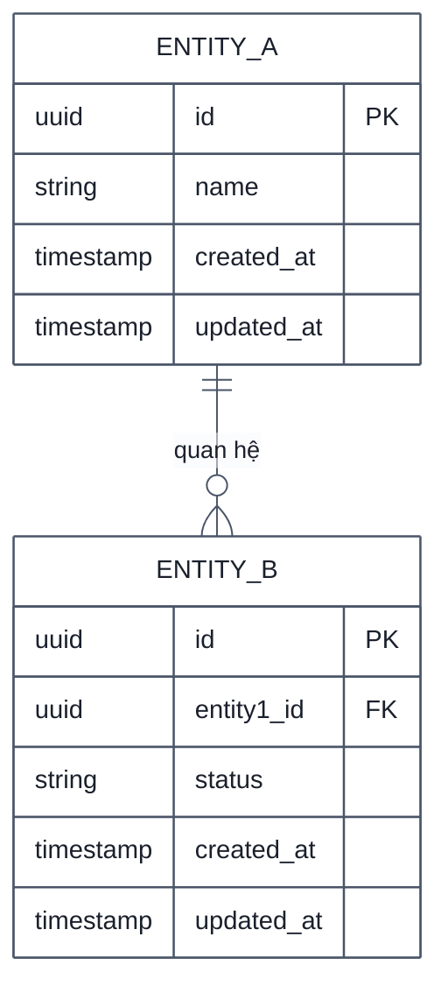

# DATA MODEL — {{TÊN DỰ ÁN}}

> **Phiên bản:** 0.1 | **Ngày:** {{DD/MM/YYYY}}
> **Tác giả:** {{Tên BA}} | **Trạng thái:** Draft

---

## 1. ERD — Entity Relationship Diagram

> Cú pháp và quy ước ERD: `BA-agent/so_do.md` mục 9.



### Ký hiệu quan hệ

| Ký hiệu | Ý nghĩa | Ví dụ |
|---------|---------|-------|
| `\|\|--o{` | 1 — 0 hoặc nhiều | 1 User có 0+ Orders |
| `\|\|--\|{` | 1 — 1 hoặc nhiều (bắt buộc) | 1 Order có ≥1 Items |
| `}o--o{` | Nhiều — nhiều | Product ↔ Category |
| `\|\|--\|\|` | 1 — đúng 1 | User ↔ Profile |

---

## 2. Data Dictionary

### Entity: {{Tên Entity 1}}

| # | Tên cột | Kiểu dữ liệu | Constraint | Mô tả | Ví dụ |
|---|--------|-------------|-----------|-------|-------|
| 1 | id | UUID | PK, NOT NULL | Khóa chính | `550e8400-e29b...` |
| 2 | {{column}} | {{type}} | {{constraint}} | {{mô tả}} | {{ví dụ}} |
| N | created_at | TIMESTAMP | NOT NULL, DEFAULT NOW | Thời điểm tạo | `2026-03-05T09:00:00Z` |
| N+1 | updated_at | TIMESTAMP | NOT NULL | Thời điểm cập nhật | `2026-03-05T10:00:00Z` |
| N+2 | deleted_at | TIMESTAMP | NULLABLE | Soft delete | `NULL` |

### Enum Values

| Entity | Field | Giá trị | Mô tả |
|--------|-------|---------|-------|
| {{Entity}} | status | `DRAFT` | Bản nháp |
| | | `PENDING` | Chờ xử lý |
| | | `APPROVED` | Đã phê duyệt |
| | | `REJECTED` | Từ chối |
| | | `CANCELLED` | Đã hủy |

---

## 3. Index Strategy

| Entity | Index Name | Columns | Loại | Lý do |
|--------|-----------|---------|------|-------|
| {{Entity}} | idx_{{entity}}_{{col}} | {{column}} | B-Tree | Tìm kiếm thường xuyên |
| {{Entity}} | idx_{{entity}}_status | status | B-Tree | Filter theo trạng thái |
| {{Entity}} | idx_{{entity}}_created | created_at | B-Tree | Sắp xếp theo thời gian |

---

## 4. Seed Data / Master Data

> Dữ liệu khởi tạo cần có khi deploy lần đầu.

| Entity | Mô tả | Số records | Nguồn |
|--------|-------|-----------|-------|
| {{Roles}} | Vai trò hệ thống | {{N}} | Cố định |
| {{Categories}} | Danh mục | {{N}} | Import từ excel |
| {{Config}} | Cấu hình hệ thống | {{N}} | Cố định |

---

## 5. Data Migration (nếu có)

| # | Từ nguồn | Đến entity | Mapping | Lưu ý |
|---|---------|-----------|---------|-------|
| 1 | {{Nguồn cũ}} | {{Entity mới}} | {{Field mapping}} | {{Data cleaning}} |

---

## ✅ Review Checklist

```
☐ ERD rõ ràng, entity chính đầy đủ
☐ Quan hệ chính xác (1:1, 1:N, N:M)
☐ Data Dictionary đầy đủ (tên, kiểu, constraint, mô tả)
☐ PK, FK rõ ràng
☐ Audit fields: created_at, updated_at, deleted_at
☐ Enum values liệt kê đầy đủ
☐ Index strategy cho query chính
☐ Seed data / master data đã xác định
```
