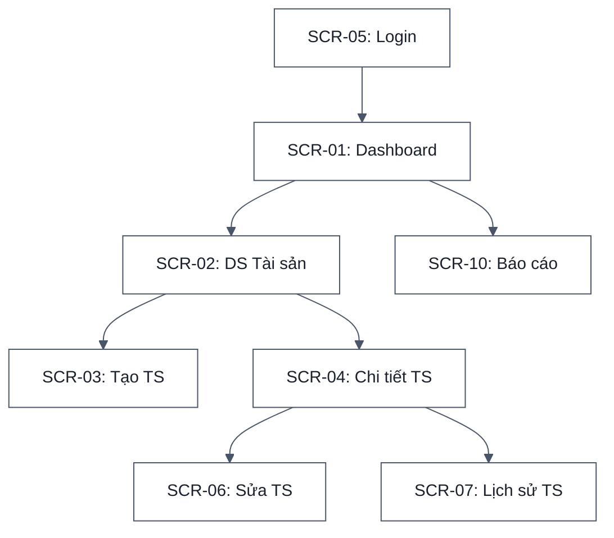

# SCREEN INVENTORY — Template

> **Tên dự án:** [Tên]
> **Ngày tạo:** [DD/MM/YYYY]
> **Phiên bản:** V1.0
> **Tổng screens:** [X]
> **Cách vẽ:** `core/screen-inventory-guide.md` mục 4 (Figma, StitchMCP hoặc HTML/PNG offline bằng `wireframe_tool.py`). Ảnh lưu trong `wireframes/`, tên bắt đầu bằng mã màn hình: `SCR-02-danh-sach-tai-san.png`.

---

## 1. Master Screen List

| Screen ID | Tên Screen | Feature | Module | Type | Actor chính | Wireframe / Mockup | Nguồn thiết kế | Status |
|---|---|---|---|---|---|---|---|---|
| SCR-01 | [VD: Dashboard Tổng quan] | F01 | [VD: Dashboard] | Dashboard | [VD: Admin] | [`wireframes/SCR-01-dashboard.png` / Chưa vẽ] | [Link Figma / mã Stitch / file .html] | [Draft / Approved] |
| SCR-02 | [VD: Danh sách Tài sản] | F05 | [VD: Quản lý TS] | List/Table | [VD: KTTS] | [`wireframes/SCR-02-danh-sach-tai-san.png`] | [`wireframes/SCR-02-danh-sach-tai-san.html`] | [Draft] |
| SCR-03 | [VD: Form Tạo Tài sản] | F05 | [VD: Quản lý TS] | Form/Input | [VD: KTTS] | [`wireframes/SCR-03-tao-tai-san.png`] | [Link Figma] | [Draft] |
| SCR-04 | [VD: Chi tiết Tài sản] | F05 | [VD: Quản lý TS] | Detail/View | [VD: KTTS] | [`wireframes/SCR-04-chi-tiet-tai-san.png`] | [Link Figma] | [Draft] |
| SCR-05 | [VD: Đăng nhập] | F02 | [VD: Auth] | Login/Auth | [VD: All] | [Không cần: dùng màn hình SSO chuẩn] | — | [Draft] |

---

## 2. Coverage Summary

| Metric | Giá trị | Target | Status |
|--------|:---:|:---:|:---:|
| Tổng Features | [X] | — | — |
| Features có Screen | [Y] | 100% | [Y/X = ?%] |
| Tổng Screens | [Z] | — | — |
| Screens có Wireframe / Mockup | [W] | 100% màn hình phức tạp (`core/screen-inventory-guide.md` mục 2) | [W/?] |
| Actors covered | [A] | = Actors trong BRD | [Match?] |

---

## 3. Screen Details

### SCR-01: [Tên Screen]

| Thuộc tính | Giá trị |
|-----------|---------|
| **Feature** | F01: [Tên Feature] |
| **Actor** | [Role] |
| **Mục đích** | [1-2 câu mô tả screen làm gì] |
| **Entry Point** | [Từ đâu navigate đến? VD: Menu trái → Dashboard] |
| **Exit Points** | [Từ screen này đi đâu? VD: Click item → SCR-04] |
| **Platform** | [Desktop / Mobile / Both] |

**Data Elements:**

| Element | Type | Source | Notes |
|---------|------|--------|-------|
| [VD: Tổng tài sản] | KPI Card | API: `/api/assets/count` | Real-time |
| [VD: Chart phân bố] | Pie Chart | API: `/api/assets/by-category` | Cached 5min |

**Actions:**

| Action | Type | Target | Permission |
|--------|------|--------|-----------|
| [VD: Xem chi tiết] | Click row | → SCR-04 | All users |
| [VD: Export CSV] | Button | Download | Admin only |

**Wireframe / Mockup:** nhúng ảnh và dòng nguồn ngay dưới (không dùng Mermaid thay wireframe khi bàn giao Tier 2–3):

```markdown

*Nguồn thiết kế: [Figma — SCR-01](<link>) | Cấp trực quan: Wireframe*
```

---

## 4. Navigation Map



---

## 5. Responsive Matrix

| Screen ID | Desktop | Tablet | Mobile | Notes |
|---|:---:|:---:|:---:|---|
| SCR-01 | Đầy đủ | Rút gọn | Tối giản | Mobile: chỉ KPI cards, ẩn charts |
| SCR-02 | Bảng đầy đủ | Cuộn ngang | Dạng thẻ | Mobile chuyển bảng thành thẻ |
| SCR-03 | Form đầy đủ | Form đầy đủ | Không hỗ trợ | Form phức tạp, chỉ Desktop/Tablet |
