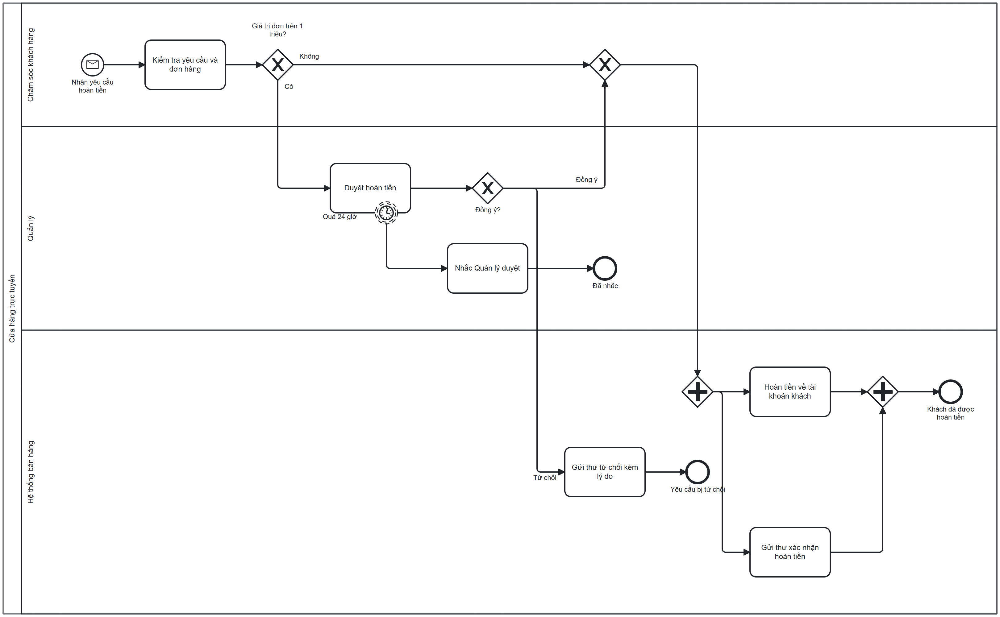
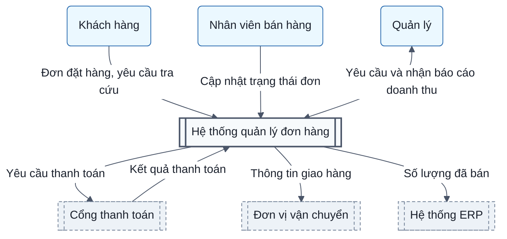
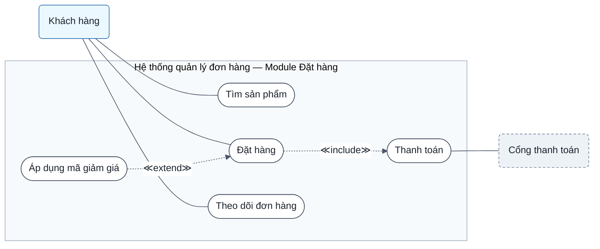
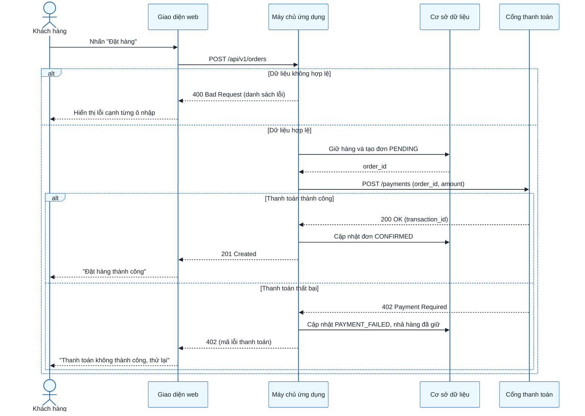
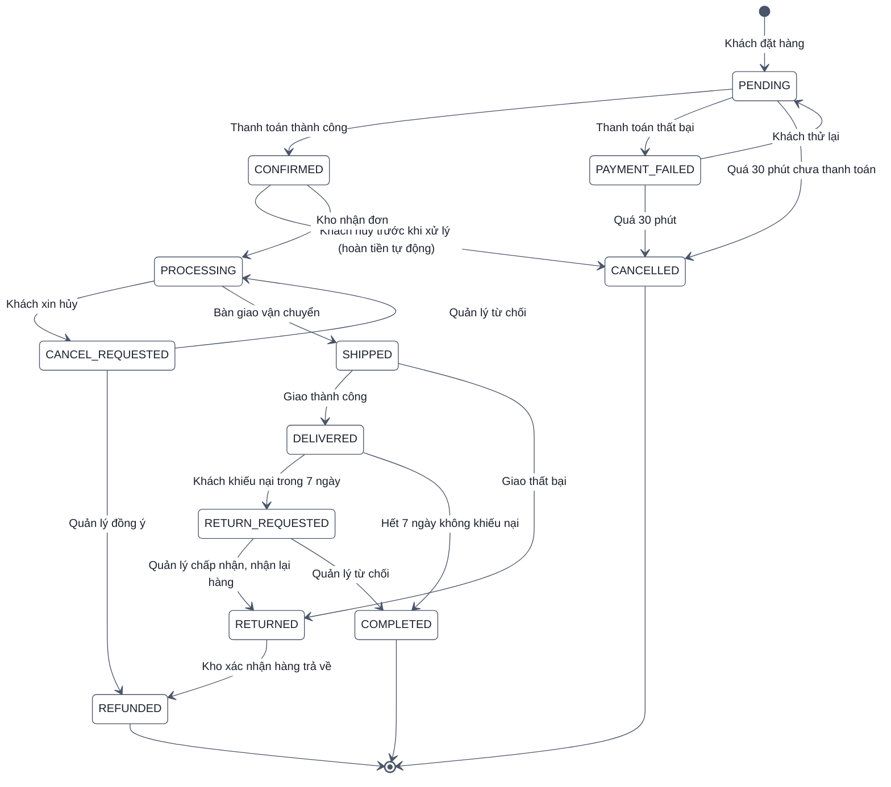
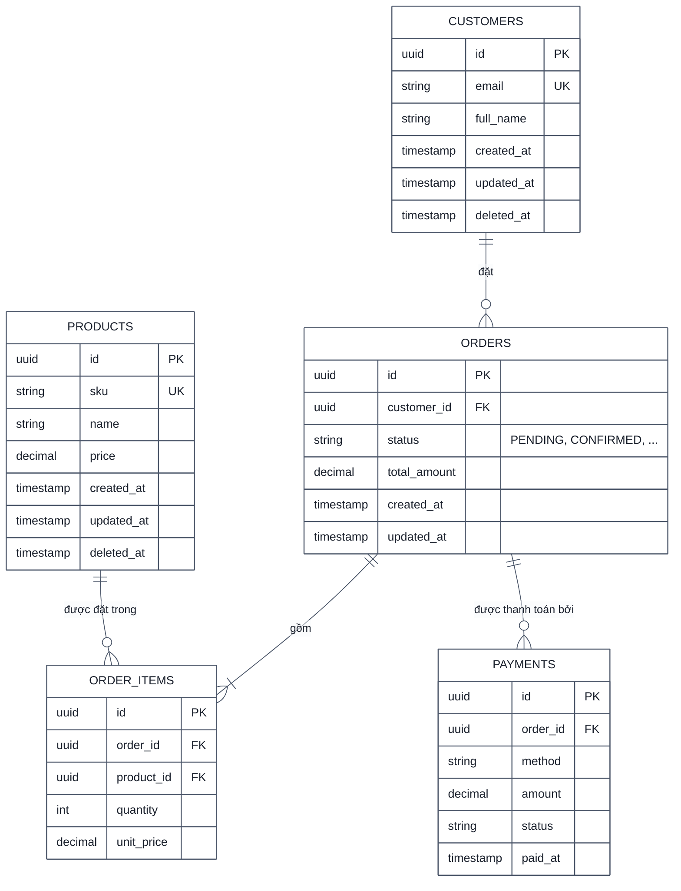
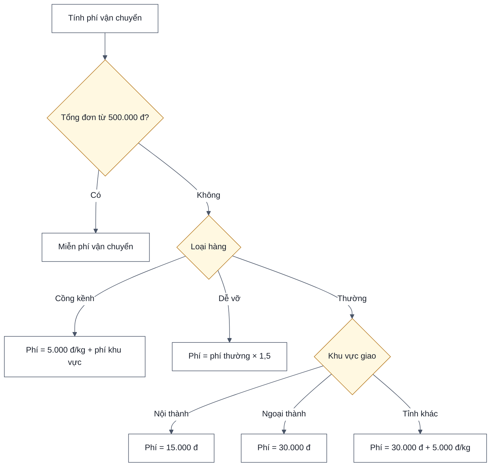
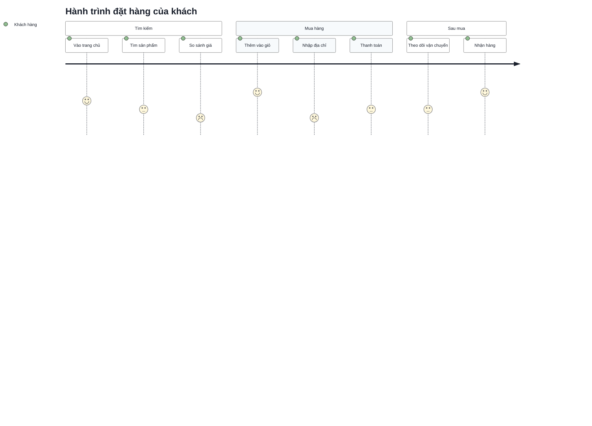
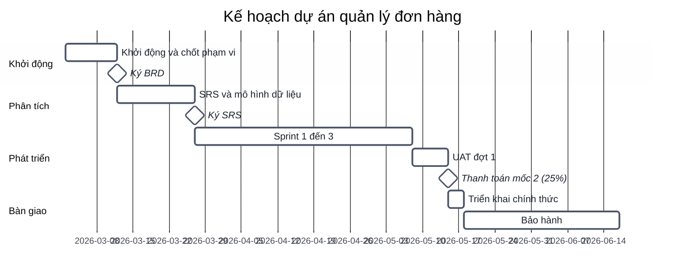

# CHUẨN VẼ SƠ ĐỒ BA

> **Phạm vi:** file chủ của mọi quy tắc vẽ sơ đồ trong BA-agent. `BA-document-rule/core/diagram-guide.md` chỉ trỏ về đây.
> **Công cụ:** quy trình nghiệp vụ vẽ bằng BPMN 2.0 (định dạng bpmn.io, mục 4); các sơ đồ còn lại vẽ bằng Mermaid trong Markdown.
> **Kiểm tra tự động:** `python BA-agent/scripts/diagram_check.py <file-hoặc-thư-mục>` (thêm `--render` để vẽ thử bằng mermaid-cli). Xuất Word kèm hình: `md_to_docx.py` (cần mermaid-cli, xem `scripts/README.md`).
> **Ví dụ minh họa:** hệ thống bán hàng trực tuyến. Ví dụ quy trình thật của một dự án: `BA-Documents-Outsource/04-Process-Flow.md`.

---

## 1. Quy tắc chung

### 1.1. Khối khai báo chuẩn

Mọi sơ đồ giao khách hàng mở đầu bằng dòng khai báo giao diện dưới đây, chép nguyên văn. Nhờ đó mọi sơ đồ cùng font, cùng màu, không dùng theme mặc định tím-vàng của Mermaid.

```text
%%{init: {"theme": "base", "fontFamily": "Arial, Helvetica, sans-serif", "themeVariables": {"fontSize": "15px", "primaryColor": "#FFFFFF", "primaryBorderColor": "#4A5568", "primaryTextColor": "#1A202C", "lineColor": "#4A5568", "secondaryColor": "#F7FAFC", "tertiaryColor": "#F7FAFC", "clusterBkg": "#F7FAFC", "clusterBorder": "#A0AEC0", "edgeLabelBackground": "#FFFFFF", "actorBkg": "#EBF8FF", "actorBorder": "#2B6CB0", "noteBkgColor": "#FFF8E1", "noteBorderColor": "#B7791F"}}}%%
```

Sơ đồ `flowchart` dùng thêm bộ lớp màu sau, đặt ở cuối sơ đồ. Chỉ dùng các lớp này, không tự đặt màu khác:

```text
    classDef startEvt fill:#E6F4EA,stroke:#2F855A,stroke-width:2px
    classDef endEvt fill:#FDECEA,stroke:#C53030,stroke-width:3px
    classDef gateway fill:#FFF8E1,stroke:#B7791F
    classDef sys fill:#F7FAFC,stroke:#4A5568,stroke-dasharray:4 3
    classDef role1 fill:#EBF8FF,stroke:#2B6CB0
    classDef role2 fill:#F0FFF4,stroke:#2F855A
    classDef role3 fill:#FAF5FF,stroke:#6B46C1
    classDef role4 fill:#FFFAF0,stroke:#C05621
    classDef pain fill:#FFF5F5,stroke:#C53030,stroke-dasharray:2 2
    classDef external fill:#EDF2F7,stroke:#718096,stroke-dasharray:4 3
```

| Lớp | Dùng cho |
|---|---|
| `startEvt`, `endEvt` | Sự kiện bắt đầu, kết thúc |
| `gateway` | Hình thoi rẽ nhánh hoặc song song |
| `role1`…`role4` | Bước do người làm, mỗi vai trò một màu; ghi chú màu dưới sơ đồ |
| `sys` | Bước hệ thống tự làm |
| `pain` | Điểm đau trong sơ đồ As-Is |
| `external` | Hệ thống hoặc tổ chức bên ngoài |

### 1.2. Mười quy tắc

| # | Quy tắc | Vì sao |
|---|---|---|
| 1 | Một sơ đồ trả lời một câu hỏi; tối đa 12 bước (không tính sự kiện) hoặc 8 use case | Quá mức này người đọc không theo được; tách thành quy trình con `[[...]]` |
| 2 | Mọi nhánh ra khỏi hình thoi đều có nhãn điều kiện, các điều kiện phủ hết khả năng | Nhánh không nhãn là nơi lập trình viên phải đoán |
| 3 | Mũi tên trong Context Diagram ghi dữ liệu di chuyển; quan hệ include/extend ghi nhãn | Mũi tên tuần tự trong một luồng không cần nhãn |
| 4 | Tên bước: Động từ + Danh từ ("Duyệt yêu cầu"); tên sự kiện kết thúc là kết quả nghiệp vụ ("Đơn đã giao") | Đọc được như câu |
| 5 | Sơ đồ nghiệp vụ (BRD, quy trình) không chứa thuật ngữ kỹ thuật: API, bảng DB, mã HTTP | Ma trận độc giả, `SKILL.md` mục 2 |
| 6 | Không emoji trong sơ đồ | Hiển thị khác nhau giữa Windows, macOS, Word; trông thiếu nghiêm túc với khách hàng |
| 7 | Không `{{placeholder}}` trong khối Mermaid | Sơ đồ báo lỗi, không hiển thị; dùng tên mẫu như `KHACH_HANG` |
| 8 | Nhãn khuôn mẫu UML viết `≪include≫`, `≪extend≫` | `<<include>>` bị đọc là thẻ HTML và hiện thành `<>` |
| 9 | Xuống dòng trong nhãn dùng `<br/>` | `\n` không hoạt động ở mọi trình hiển thị |
| 10 | Quy trình ngắn (đến 8 bước) vẽ `flowchart LR`; dài hơn vẽ `flowchart TD` | Sơ đồ quá rộng bị thu nhỏ trong Word, chữ không đọc được |

---

## 2. Chọn sơ đồ

| Level | Sơ đồ | Câu hỏi trả lời | Đặt trong | Người đọc chính |
|---|---|---|---|---|
| 0 | Context Diagram | Hệ thống trao đổi dữ liệu với ai? | Vision & Scope, BRD | Sponsor, PO |
| 1 | Use Case Diagram | Ai làm được gì với hệ thống? | BRD, SRS | PO, Dev |
| 2 | Quy trình nghiệp vụ (BPMN 2.0) | Công việc chạy qua những ai, rẽ nhánh ở đâu? | Process Flow, BRD | SME, Dev, QC |
| 2 | Decision Flowchart | Quy tắc nhiều điều kiện cho kết quả gì? | SRS (Business Rules) | Dev, QC |
| 2 | User Journey | Người dùng cảm thấy thế nào qua từng bước? | Vision & Scope | PO, UX |
| 3 | Sequence Diagram | Các thành phần gọi nhau theo thứ tự nào? | SRS (tích hợp) | Dev |
| 3 | State Diagram | Một đối tượng chuyển trạng thái ra sao? | SRS, Data Model | Dev, QC |
| 3 | ERD | Dữ liệu liên kết thế nào? | Data Model, SRS | Dev, DBA |
| — | Gantt | Mốc thời gian, mốc thanh toán | Vision & Scope, kế hoạch | PM, Sponsor |

Không trộn level trong một sơ đồ: Context không có bước xử lý, quy trình nghiệp vụ không có lời gọi API.

---

## 3. Hình khối và đường nối (flowchart)

| Hình | Cú pháp | Dùng cho |
|---|---|---|
| Chữ nhật | `A["Tạo đơn"]` | Bước công việc |
| Hình tròn | `S(("Khách gửi yêu cầu"))` | Sự kiện bắt đầu |
| Tròn viền kép | `E((("Đơn đã giao")))` | Sự kiện kết thúc |
| Hình thoi | `G{"Đủ điều kiện?"}` | Rẽ nhánh loại trừ (một nhánh được đi) |
| Hình thoi dấu cộng | `P1{"+"}` | Rẽ song song và điểm hợp (luôn đi thành cặp) |
| Viên thuốc | `W(["Chờ: 48 giờ"])` | Sự kiện chờ thời gian hoặc chờ tin nhắn; Use Case trong sơ đồ Use Case |
| Viền đôi | `X[["Quy trình con: Thanh toán"]]` | Quy trình con được vẽ riêng; hệ thống trong Context |
| Hình trụ | `D[("Sổ tài sản")]` | Kho dữ liệu |
| Bình hành | `F[/"Phiếu đề nghị"/]` | Chứng từ, dữ liệu vào/ra |

| Đường nối | Cú pháp | Dùng cho |
|---|---|---|
| Liền | `A --> B` | Luồng tuần tự |
| Liền có nhãn | `G -->\|"Có"\| B` | Nhánh của hình thoi |
| Nét đứt có nhãn | `A -.->\|"Email thông báo"\| B` | Thông tin gửi sang bên ngoài; include/extend |
| Không mũi tên | `A --- B` | Actor nối Use Case |

---

## 4. Quy trình nghiệp vụ: BPMN 2.0

Quy trình nghiệp vụ (As-Is, To-Be, quy trình con) trong tài liệu giao khách vẽ bằng **BPMN 2.0** (ISO/IEC 19510), định dạng của bpmn.io. Mỗi quy trình có ba file trong thư mục `diagrams/` của bộ tài liệu:

| File | Vai trò |
|---|---|
| `<tên>.bpmn` | **Bản chuẩn.** XML BPMN 2.0 kèm bố cục; mở, sửa, xuất ảnh bằng bpmn.io (demo.bpmn.io) hoặc Camunda Modeler; nhập được vào Bizagi, Signavio, Visio |
| `<tên>.json` | Bản mô tả ngắn để AI hoặc BA sinh nhanh `.bpmn` bằng `scripts/bpmn_tool.py` |
| `<tên>.png` | Ảnh chèn vào tài liệu: `` kèm liên kết tới `.bpmn` |

Sửa quy trình theo một trong hai cách, không trộn: (a) sửa `.json` rồi sinh lại `.bpmn` và `.png`; (b) sửa thẳng `.bpmn` trên Modeler rồi xuất `.png` (và chạy `bpmn_tool.py check`), khi đó xóa `.json` để không ai sinh đè bản đã sửa tay.

draw.io không mở trực tiếp `.bpmn`. Khách dùng draw.io thì gửi kèm ảnh PNG/SVG; nếu khách cần sửa được trên draw.io, vẽ lại bằng bộ hình BPMN của draw.io và lưu `.drawio` làm bản chuẩn thay cho `.bpmn`.

### 4.1. Ký hiệu dùng trong tài liệu BA

| Ký hiệu BPMN 2.0 | Dùng khi | `type` trong `.json` |
|---|---|---|
| Pool | Tổ chức chủ quy trình | `"pool"` |
| Lane | Một vai trò hoặc phòng ban; mỗi bước nằm trong đúng một lane | `"lanes"`, `"lane"` của từng bước |
| Start Event (vòng tròn mảnh) | Sự kiện kích hoạt; hẹn giờ (đồng hồ) hoặc nhận tin (phong bì) | `start`, `start_timer`, `start_message` |
| User Task | Người làm trên hệ thống | `user` |
| Manual Task | Người làm tay, ngoài hệ thống (thường gặp ở As-Is) | `manual` |
| Service Task | Hệ thống tự làm | `service` |
| Send Task | Gửi thông báo, email | `send` |
| Business Rule Task | Kiểm tra theo luật nghiệp vụ (ghi mã BR) | `business_rule` |
| Exclusive Gateway (X) | Rẽ đúng một nhánh; tên là câu hỏi, mỗi nhánh có nhãn điều kiện | `xor` |
| Parallel Gateway (+) | Các nhánh chạy cùng lúc; luôn có cặp tách và hợp | `and` |
| Inclusive Gateway (O) | Một hoặc nhiều nhánh theo điều kiện | `or` |
| Boundary Timer (đồng hồ trên cạnh task) | Quá hạn mà bước chưa xong; viền đứt = không ngắt bước đang chờ | `boundary_timer` + `attached_to`, `"interrupting": false` |
| Intermediate Timer / Message | Chờ thời gian hoặc chờ tin giữa luồng | `timer`, `message_catch`, `message_throw` |
| Sub-Process | Quy trình con vẽ riêng | `subprocess` |
| End Event (vòng tròn viền đậm) | Mỗi kết quả nghiệp vụ một sự kiện kết thúc | `end`, `end_message` |

Các loại task (`user`, `manual`, `service`, `send`, `business_rule`) được ghi trong `.json` để người đọc file nguồn biết ai làm và làm bằng gì, nhưng mặc định vẽ thành task thường, không biểu tượng ở góc ô: biểu tượng đè lên tên bước khi ô nhỏ. Cần hiện biểu tượng (ví dụ khách yêu cầu) thì thêm `"task_icons": true` vào `.json`. Ai làm bước đọc từ lane; hệ thống tự làm thì đặt bước trong lane "Hệ thống".

Ô viền đỏ (`"highlight": "pain"`) đánh dấu bước gây điểm đau trong As-Is; ô viền xanh (`"highlight": "new"`) đánh dấu bước mới của To-Be. Màu lưu bằng phần mở rộng màu của bpmn.io, Modeler đọc được.

### 4.2. Bản mô tả `.json`

```json
{
  "id": "hoan_tien", "name": "Duyệt hoàn tiền đơn hàng", "pool": "Cửa hàng trực tuyến",
  "lanes": [{"id": "cskh", "name": "Chăm sóc khách hàng"}, {"id": "quan_ly", "name": "Quản lý"}],
  "nodes": [
    {"id": "start", "type": "start_message", "name": "Nhận yêu cầu hoàn tiền", "lane": "cskh"},
    {"id": "g1", "type": "xor", "name": "Giá trị đơn trên 1 triệu?", "lane": "cskh"},
    {"id": "timer", "type": "boundary_timer", "name": "Quá 24 giờ", "attached_to": "t2", "interrupting": false}
  ],
  "flows": [["start", "t1"], ["g1", "t2", "Có"], {"from": "g1", "to": "m1", "name": "Không"}]
}
```

Mỗi bước có thể thêm `"row"` (xếp hàng thứ mấy trong lane, bắt đầu từ 0) để tách nhánh phụ khỏi luồng chính, và `"col"` khi cần ép cột. Bố cục còn lại do script tự tính: luồng từ trái sang phải, đoạn đi dọc chạy ở khe giữa các cột, nhãn cổng đặt phía không có đường ra.

Lệnh:

```text
python BA-agent/scripts/bpmn_tool.py build diagrams/hoan-tien.json --png diagrams/hoan-tien.png
python BA-agent/scripts/bpmn_tool.py check diagrams            # kiểm tra mọi .bpmn, kể cả bản sửa tay
python BA-agent/scripts/bpmn_tool.py render diagrams/hoan-tien.bpmn diagrams/hoan-tien.svg
```

`build` và `check` chạy bằng Python thuần. Vẽ ảnh cần Node.js và bpmn-js (`npm install --prefix BA-agent/scripts`, xem `scripts/README.md`). Script không ghi `.bpmn` khi mô hình còn lỗi: luồng cụt, phần tử lơ lửng, nhánh của cổng loại trừ thiếu điều kiện, bước không thuộc lane nào, sự kiện biên không gắn vào task.

### 4.3. Ví dụ



Bản chuẩn: [`diagrams/vi-du-hoan-tien.bpmn`](diagrams/vi-du-hoan-tien.bpmn), mô tả: [`diagrams/vi-du-hoan-tien.json`](diagrams/vi-du-hoan-tien.json). Đọc sơ đồ: đơn đến 1 triệu đi thẳng tới điểm gộp; đơn lớn hơn chờ Quản lý duyệt, quá 24 giờ thì hệ thống nhắc nhưng bước duyệt vẫn chờ (sự kiện biên không ngắt); khi đồng ý, hệ thống hoàn tiền và gửi thư cùng lúc (cổng song song), cả hai xong mới kết thúc.

Ví dụ quy trình thật của một dự án (3 quy trình, As-Is và To-Be): `BA-Documents-Outsource/04-Process-Flow.md`.

### 4.4. Quy tắc mô hình

1. Một sơ đồ một quy trình, tối đa khoảng 15 bước; dài hơn thì tách quy trình con.
2. Tên bước: Động từ + Danh từ. Tên cổng loại trừ là câu hỏi; nhãn nhánh là câu trả lời ("Có", "Từ chối", "Quá 48 giờ").
3. Mỗi cổng song song tách phải có cổng hợp; nhiều luồng nhập vào một bước thì đặt cổng gộp (XOR không tên) trước bước đó.
4. Quy tắc nghiệp vụ quyết định một nhánh ghi mã BR ở tên cổng hoặc tên bước kiểm tra ("Kiểm tra trạng thái tài sản (BR-003)").
5. Chờ có hạn dùng sự kiện hẹn giờ gắn biên; ghi rõ hành động khi quá hạn.
6. Sơ đồ nghiệp vụ không chứa thuật ngữ kỹ thuật (API, bảng dữ liệu, mã HTTP); phần đó thuộc Sequence Diagram trong SRS.
7. Sơ đồ As-Is được người làm quy trình (SME) xác nhận; chưa xác nhận thì ghi `[CẦN XÁC NHẬN]` cạnh tên sơ đồ.

### 4.5. Phác thảo nhanh bằng Mermaid (BPMN-lite)

Khi đang trao đổi trong cuộc chat, cần nhìn hướng trước khi chốt, hoặc máy không có Node.js, được phác thảo bằng Mermaid theo quy ước dưới đây. Bản phác thảo không thay sơ đồ BPMN 2.0 trong tài liệu giao khách.

Ký hiệu:

| BPMN 2.0 | BPMN-lite trong Mermaid |
|---|---|
| Start Event | `S(("Sự kiện kích hoạt"))` + `class S startEvt` |
| End Event | `E((("Kết quả nghiệp vụ")))` + `endEvt`; mỗi kết quả khác nhau một sự kiện kết thúc |
| Task trong Lane | `T1["<b>Vai trò</b><br/>Động từ + danh từ"]` + lớp `role1`…`role4` (bước hệ thống: `<b>Hệ thống</b>` + `sys`) |
| Exclusive Gateway (XOR) | `G1{"Câu hỏi?"}` + `gateway`; mọi nhánh có nhãn |
| Parallel Gateway (AND) | `P1{"+"}` tách, `P2{"+"}` hợp, cùng lớp `gateway`; các nhánh song song phải gặp nhau ở điểm hợp |
| Timer / Message Event | `W1(["Chờ: 48 giờ"])` hoặc đưa vào câu hỏi của gateway ("Xác nhận trong 48 giờ?") |
| Sub-process | `X[["Quy trình con: tên"]]`, vẽ riêng ở mục khác |
| Message Flow giữa tổ chức | `A -.->\|"Nội dung tin"\| B` |
| Data Store | `D[("Tên kho")]` |

Dưới mỗi sơ đồ ghi một dòng chú giải màu: "Xanh dương: Khoa giao · Xanh lá: Phòng Vật tư · Viền đứt: Hệ thống".

Ví dụ phác thảo:

```mermaid
%%{init: {"theme": "base", "fontFamily": "Arial, Helvetica, sans-serif", "themeVariables": {"fontSize": "15px", "primaryColor": "#FFFFFF", "primaryBorderColor": "#4A5568", "primaryTextColor": "#1A202C", "lineColor": "#4A5568", "secondaryColor": "#F7FAFC", "tertiaryColor": "#F7FAFC", "clusterBkg": "#F7FAFC", "clusterBorder": "#A0AEC0", "edgeLabelBackground": "#FFFFFF", "actorBkg": "#EBF8FF", "actorBorder": "#2B6CB0", "noteBkgColor": "#FFF8E1", "noteBorderColor": "#B7791F"}}}%%
flowchart LR
    S(("Khách gửi yêu cầu<br/>hoàn tiền")) --> T1["<b>CSKH</b><br/>Kiểm tra yêu cầu"]
    T1 --> G1{"Giá trị đơn"}
    G1 -->|"Đến 1 triệu"| T3
    G1 -->|"Trên 1 triệu"| T2["<b>Quản lý</b><br/>Duyệt hoàn tiền"]
    T2 --> G2{"Đồng ý?"}
    G2 -->|"Từ chối"| T6["<b>Hệ thống</b><br/>Gửi thư từ chối kèm lý do"]
    T6 --> E2((("Yêu cầu bị<br/>từ chối")))
    G2 -->|"Đồng ý"| T3["<b>CSKH</b><br/>Xác nhận hoàn tiền"]
    T3 --> P1{"+"}
    P1 --> T4["<b>Hệ thống</b><br/>Hoàn tiền về tài khoản"]
    P1 --> T5["<b>Hệ thống</b><br/>Gửi thư xác nhận"]
    T4 --> P2{"+"}
    T5 --> P2
    P2 --> E1((("Khách đã được<br/>hoàn tiền")))

    classDef startEvt fill:#E6F4EA,stroke:#2F855A,stroke-width:2px
    classDef endEvt fill:#FDECEA,stroke:#C53030,stroke-width:3px
    classDef gateway fill:#FFF8E1,stroke:#B7791F
    classDef sys fill:#F7FAFC,stroke:#4A5568,stroke-dasharray:4 3
    classDef role1 fill:#EBF8FF,stroke:#2B6CB0
    classDef role2 fill:#F0FFF4,stroke:#2F855A
    class S startEvt
    class E1,E2 endEvt
    class G1,G2,P1,P2 gateway
    class T1,T3 role1
    class T2 role2
    class T4,T5,T6 sys
```



### 4.6. Cách thu thập để vẽ

| Câu hỏi | Thành phần |
|---|---|
| Quy trình bắt đầu khi có chuyện gì? | Sự kiện bắt đầu |
| Bước tiếp theo là gì, ai làm? | Bước + vai trò |
| Có trường hợp nào đi đường khác? | Cổng loại trừ |
| Việc nào làm cùng lúc? | Cổng song song |
| Chờ bao lâu thì xử lý thế nào? | Sự kiện chờ |
| Nếu lỗi hoặc bị từ chối thì sao? | Nhánh ngoại lệ |
| Kết thúc với kết quả gì? Có mấy kết quả? | Sự kiện kết thúc |
| Bước nào hệ thống tự làm? | Lớp `sys` |

Thứ tự vẽ: luồng chính trước, rồi rẽ nhánh, ngoại lệ, chờ thời gian, cuối cùng tô màu vai trò. Kỹ thuật thu thập (phỏng vấn, quan sát, workshop): `BA-document-rule/references/elicitation-playbook.md`.

---

---

## 5. Context Diagram

Hệ thống ở giữa, người dùng phía trên, hệ thống ngoài phía dưới. Mũi tên ghi dữ liệu đi qua, không ghi tên chức năng. Tối đa 6 nhóm người dùng và 5 hệ thống ngoài.



---

## 6. Use Case Diagram

Mermaid không có ký hiệu UML Use Case; quy ước: actor là hình bo tròn ngoài khung hệ thống, use case là hình viên thuốc trong khung `subgraph`, actor nối use case bằng `---`. Mỗi sơ đồ tối đa 8 use case; nhiều hơn thì tách theo module hoặc theo actor.



| Quan hệ | Nghĩa | Chiều mũi tên | Ví dụ |
|---|---|---|---|
| `≪include≫` | Use case chính luôn gọi use case con | Từ use case chính tới use case con | "Đặt hàng" include "Thanh toán" |
| `≪extend≫` | Use case phụ chỉ chạy khi có điều kiện | Từ use case phụ tới use case chính | "Áp dụng mã giảm giá" extend "Đặt hàng" |
| Kế thừa actor | Actor con làm được mọi việc của actor cha | Từ actor con tới actor cha, nhãn "kế thừa" | "Quản lý" kế thừa "Nhân viên" |

Sai thường gặp: phòng ban làm actor (actor là vai trò); một bước nhỏ thành use case (use case là mục tiêu của actor); bước kỹ thuật như "Xác thực token" thành use case.

---

## 7. Sequence Diagram

Thứ tự participant từ trái sang phải: người dùng, giao diện, máy chủ, cơ sở dữ liệu, hệ thống ngoài. Yêu cầu dùng `->>`, phản hồi dùng `-->>`. Ghi tên lời gọi cụ thể (`POST /api/v1/orders`). Mỗi điều kiện dùng `alt` có đủ `else`; luồng lỗi kết thúc trong nhánh của nó.



---

## 8. State Diagram

Tên trạng thái viết HOA, khớp enum trong code. Mỗi trạng thái có đường ra (trừ trạng thái cuối); trạng thái chờ có thời hạn thì ghi chuyển trạng thái khi hết hạn. Khi một hành động đưa về các trạng thái khác nhau tùy nơi bắt đầu, tách thành hai trạng thái (hủy trước khi giao khác trả hàng sau khi giao).



---

## 9. ERD

Mỗi bảng có `id` (PK), `created_at`, `updated_at`; bảng nghiệp vụ chính có `deleted_at` khi cần xóa mềm. Quan hệ nhiều-nhiều qua bảng trung gian.

| Ký hiệu | Nghĩa |
|---|---|
| `\|\|--o{` | Một – không hoặc nhiều |
| `\|\|--\|{` | Một – một hoặc nhiều (bắt buộc) |
| `\|\|--\|\|` | Một – đúng một |
| `}o--o{` | Nhiều – nhiều (cần bảng trung gian) |



---

## 10. Decision Flowchart

Dùng khi một quy tắc có nhiều điều kiện lồng nhau. Mọi nhánh có nhãn; mỗi kết quả là một bước có giá trị cụ thể. Nếu quá 4 tầng điều kiện, chuyển sang bảng quyết định trong SRS.



---

## 11. User Journey

Điểm 1–5 là mức hài lòng; bước điểm 1–2 là điểm đau cần đưa vào BRD.



---

## 12. Gantt

Mốc thanh toán và mốc ký duyệt dùng `milestone`. Ngày bắt đầu là ngày thật (`YYYY-MM-DD`), không để trống.



---

## 13. Kiểm tra trước khi gửi sơ đồ

Tự động: `bpmn_tool.py check` cho sơ đồ BPMN; `diagram_check.py` cho sơ đồ Mermaid (khối khai báo chuẩn, nhánh của hình thoi có nhãn, không `{{placeholder}}`, không `<<...>>` trong flowchart, không emoji, số bước không quá ngưỡng). Thêm `--render` để chắc sơ đồ vẽ được.

Đọc tay:

| # | Câu hỏi |
|---|---|
| 1 | Có sự kiện bắt đầu, và mỗi kết quả nghiệp vụ có sự kiện kết thúc riêng? |
| 2 | Nhánh của mỗi hình thoi phủ hết khả năng (không còn trường hợp "khác")? |
| 3 | Mỗi nhánh song song có điểm hợp? |
| 4 | Mỗi bước có đúng một vai trò làm? |
| 5 | Chờ thời gian có hạn và có hành động khi quá hạn? |
| 6 | Đúng level cho người đọc (mục 2), không lẫn thuật ngữ kỹ thuật vào sơ đồ nghiệp vụ? |
| 7 | Tên bước, quy tắc, ngưỡng khớp BRD/SRS (ví dụ BR-002 trong sơ đồ và trong BRD cùng nội dung)? |
| 8 | Người làm quy trình (SME) đã xem và xác nhận? Sơ đồ As-Is chưa được SME xác nhận thì ghi `[CẦN XÁC NHẬN]` cạnh tên sơ đồ. |

---

## 14. Công cụ

| Công cụ | Dùng khi |
|---|---|
| Mermaid | Mặc định, viết cùng tài liệu Markdown, kiểm tra bằng script |
| mermaid-cli (`mmdc`) | Vẽ sơ đồ thành ảnh khi xuất Word hoặc PDF |
| bpmn.io / Camunda Modeler | Mở, sửa, xuất ảnh file `.bpmn` của quy trình (mục 4) |
| `bpmn_tool.py` | Sinh `.bpmn` từ bản mô tả `.json`, kiểm tra mô hình, vẽ ảnh |
| draw.io | Sơ đồ kiến trúc; BPMN khi khách bắt buộc dùng draw.io (khi đó `.drawio` là bản chuẩn) |
| Miro, FigJam | Vẽ nháp cùng khách trong workshop; sau đó vẽ lại bằng Mermaid hoặc BPMN 2.0 |
